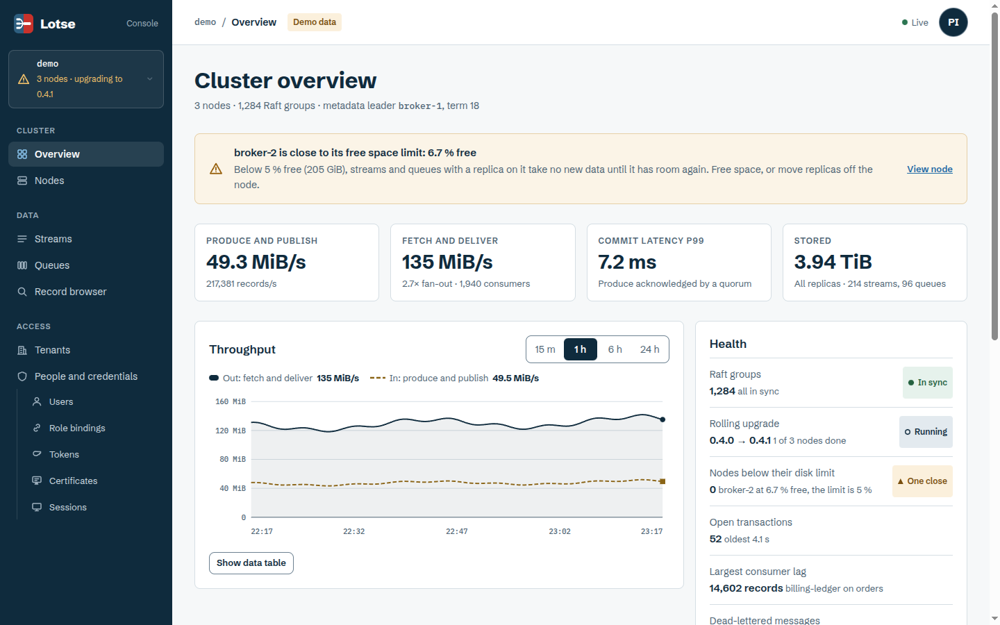
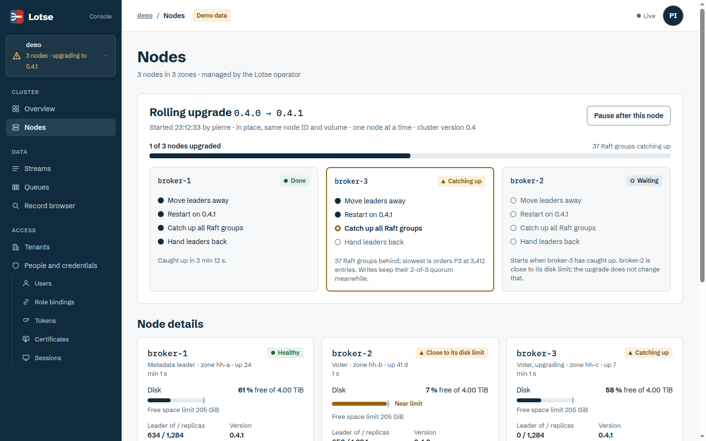
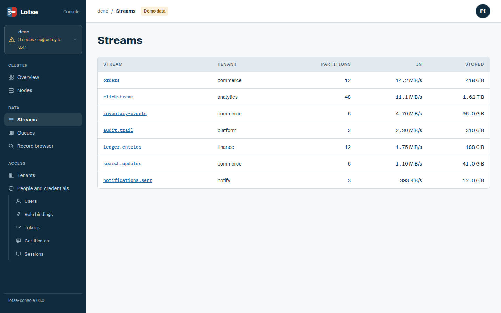
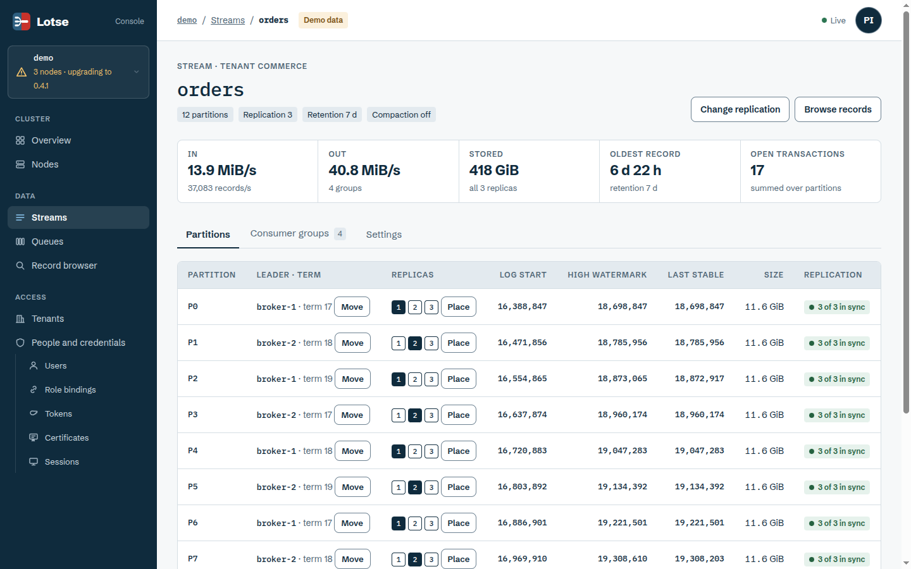
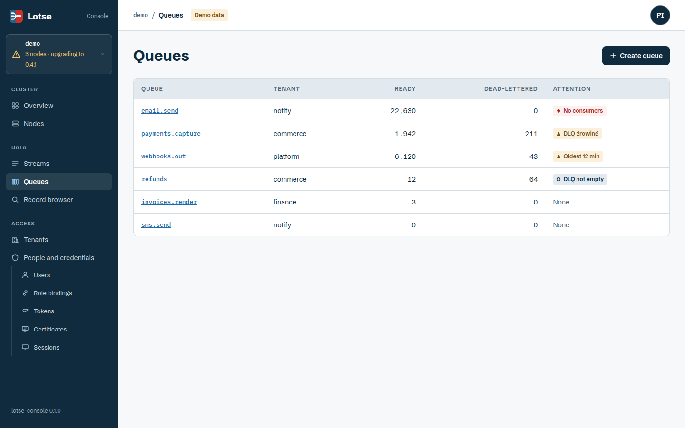
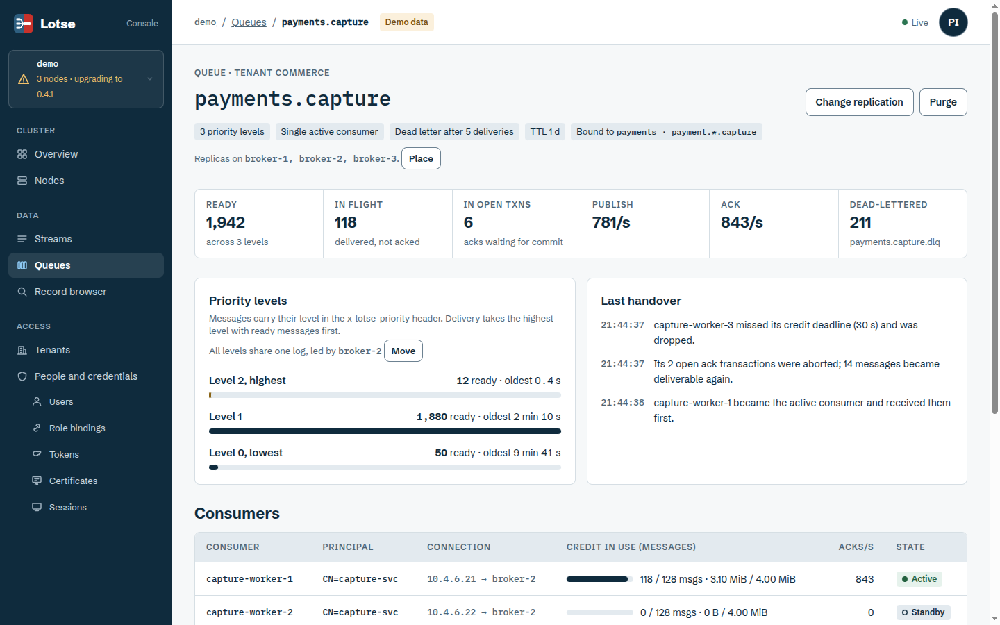
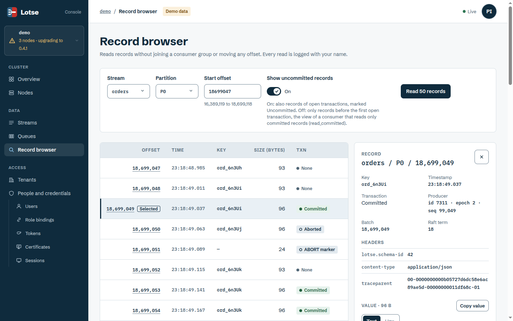
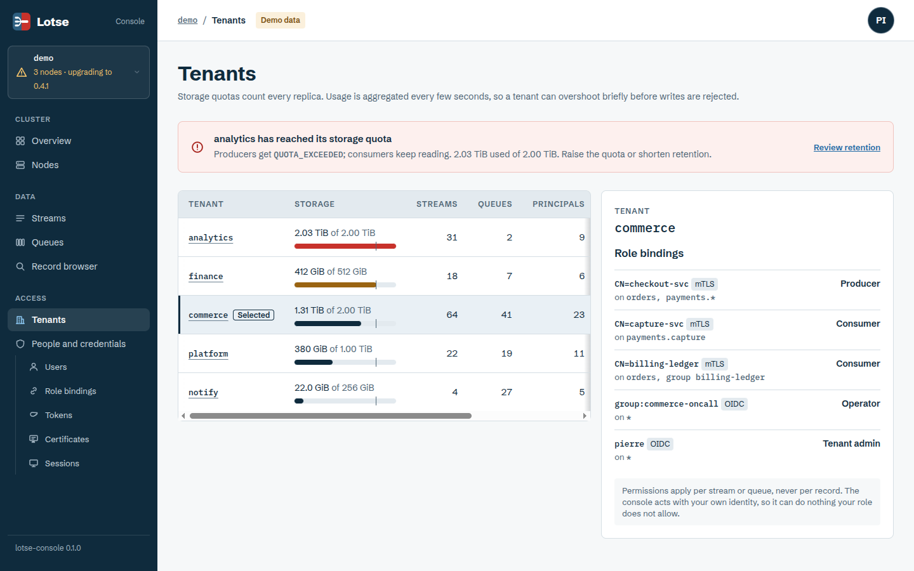
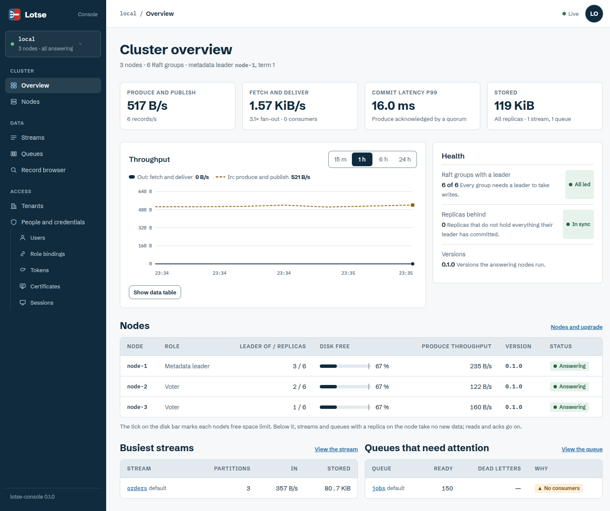
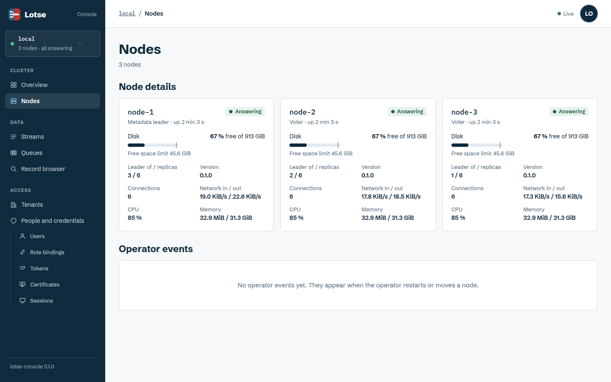

# Management console

`lotse-console` runs on a dedicated node and serves the web app from `console/web`. These screenshots show it against the built-in demo cluster (see [Running it](#running-it) below).

| Page | |
| --- | --- |
| Cluster overview |  |
| Nodes and rolling upgrade |  |
| Streams |  |
| Stream detail |  |
| Queues |  |
| Queue detail |  |
| Record browser |  |
| Tenants |  |
| Access tokens (*People and credentials*, *Tokens*) | Screenshot to be taken |

## Against a real cluster

The same console in front of three nodes on localhost (`cargo run -p lotse-console --example local_cluster`): numbers come from `DescribeMetrics`, and what the cluster does not have yet (tenants, zones, disk limits, an operator) is left out or shown as `—`.

| Page | |
| --- | --- |
| Cluster overview |  |
| Nodes |  |

## Mockups

[`mockups/v2/`](mockups/v2/) holds the mockups of the current design: open `index.html`; its README lists the decisions. [`mockups/`](mockups/) holds the earlier mockups the console was first built from, one page per file, as made on a design canvas (`canvas.json` lays them out). They are HTML with template placeholders that a canvas runtime fills in, so they do not render on their own in a browser; read them as markup, or look at the screenshots above for what was built.

Styling follows the [brand](../brand/): tokens from [`tokens.json`](../brand/tokens.json), the same values as `console/web/src/styles.css`.

## Running it

`lotse-console` is one binary. It embeds the React app from `console/web` and talks to the clusters on behalf of the signed-in user. A cluster with `kind = "native"` is a real one, reached through `lotse-client` at its `bootstrap` addresses; the console asks every node for its metrics and turns counters into rates (ADR 0036). A cluster with `kind = "demo"` serves sample data that moves over time.

```sh
cd console/web && npm ci && npm run build && cd ../..      # build the web app first
cargo run -p lotse-console --example local_cluster          # three real nodes on localhost, with the console
cargo run -p lotse-console -- --config console/lotse-console.example.toml   # or: the console alone, as configured
# open http://127.0.0.1:8080
```

Users sign in with OpenID Connect at the issuer the brokers trust (`[auth] mode = "oidc"`), or, on a machine only you can reach, in `dev` mode as one configured user with an optional SCRAM password. The console passes the user's access token (or password) to the cluster, one client per principal, so every screen shows what that user's roles allow (ADR 0040). Sessions are sealed into the cookie with a key the console makes once in its data directory, so a restart keeps users signed in (ADR 0042); the metrics sampler signs in with client credentials; charts sum only the streams and queues the user may see (ADR 0041). What a real cluster does not report yet (quotas, an operator) shows as `—` or is left out.

For frontend work, run `npm run dev` in `console/web` next to a running `lotse-console`; Vite proxies `/api` and the WebSocket to port 8080. After changing an API type in Rust, run `npm run api` to regenerate `openapi.json` and the TypeScript client; CI fails if they drift.

Frontend stack: React 19, TypeScript, Radix primitives, React Router, TanStack Query with `openapi-fetch`. Styles use the Lotse tokens, light and dark.
