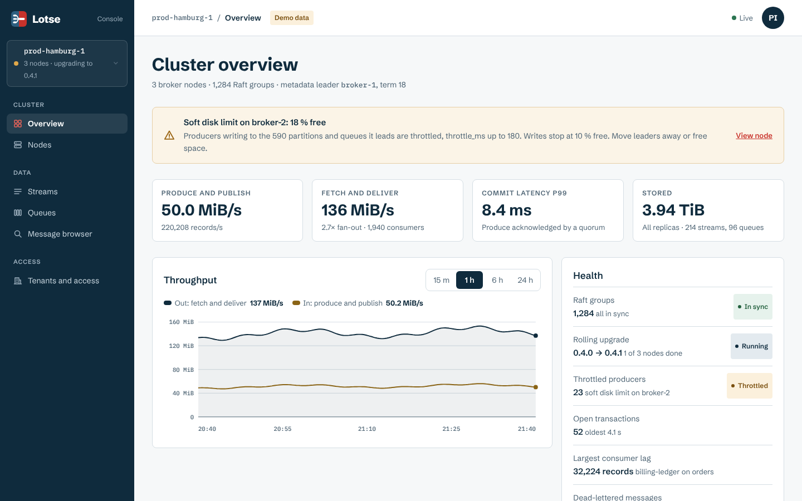
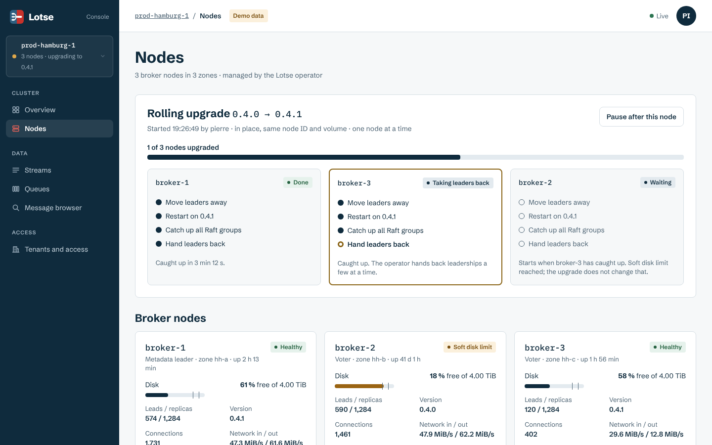
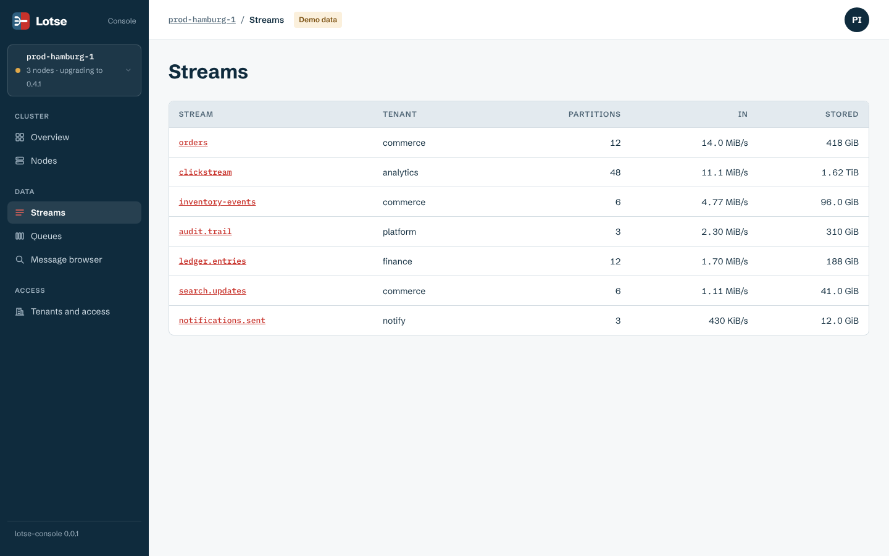
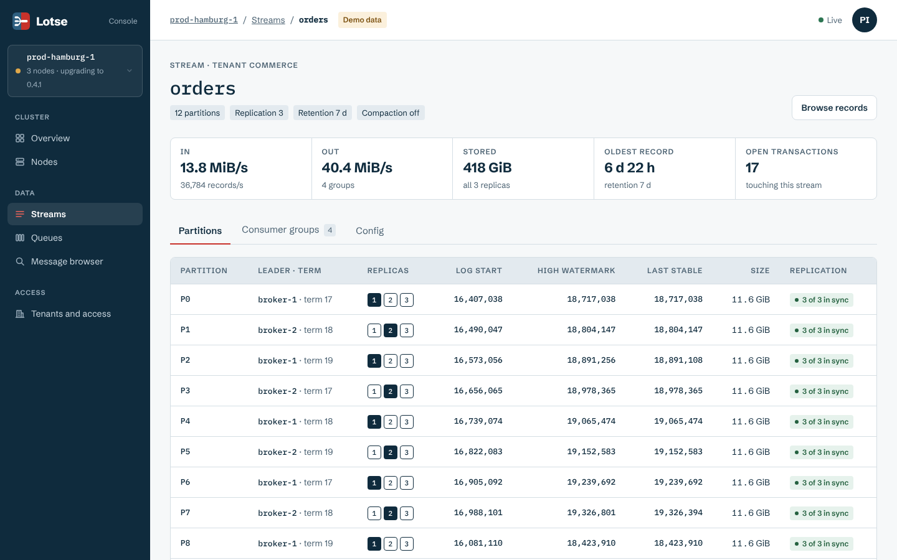
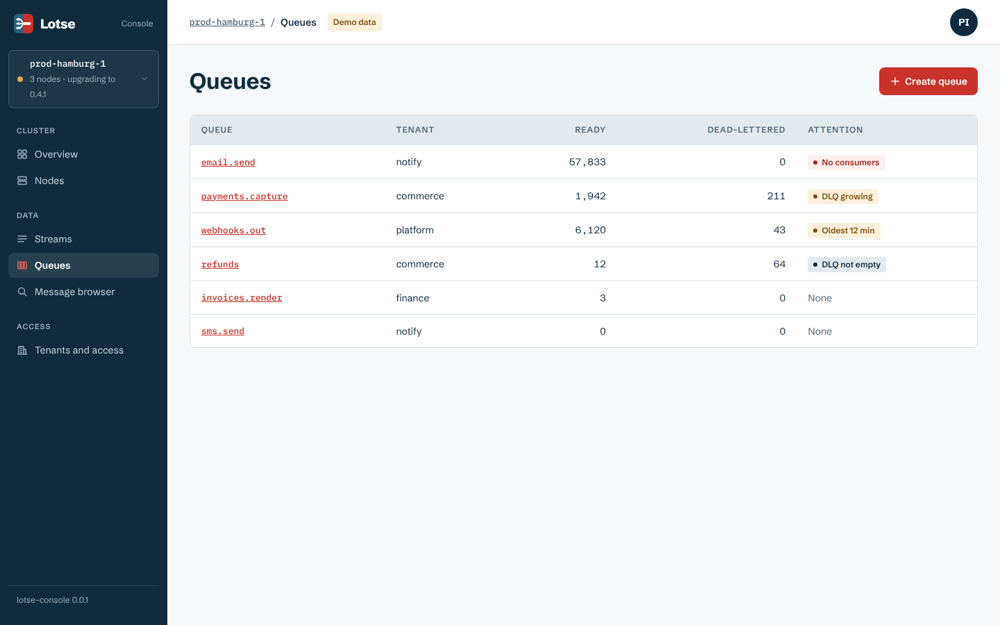
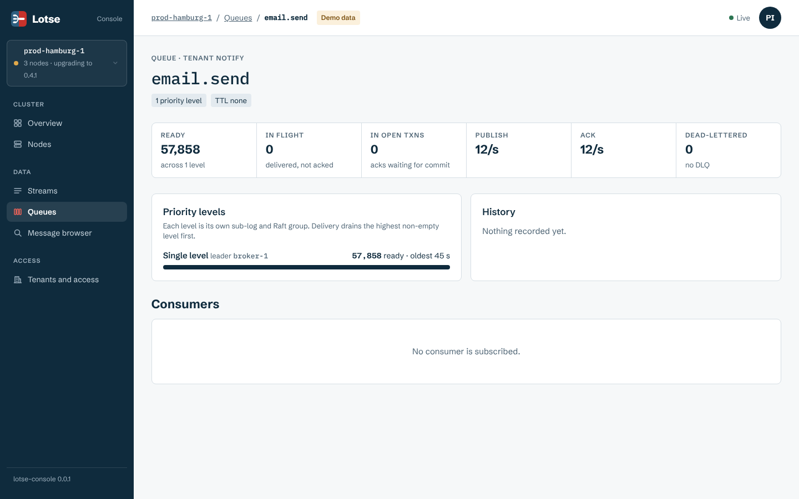
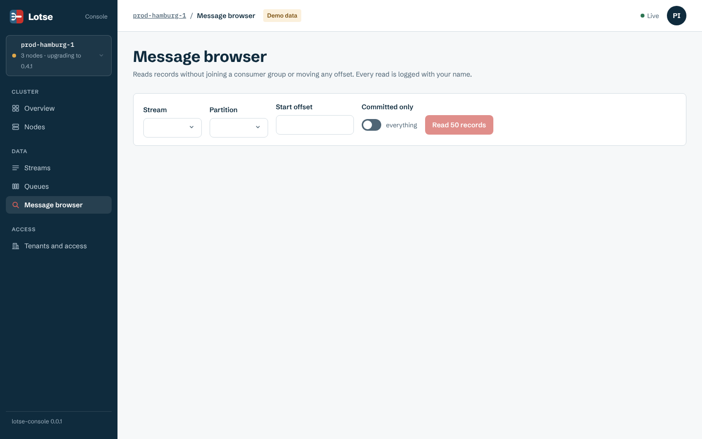
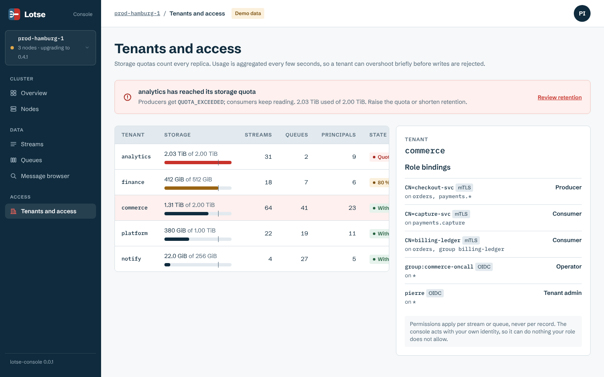
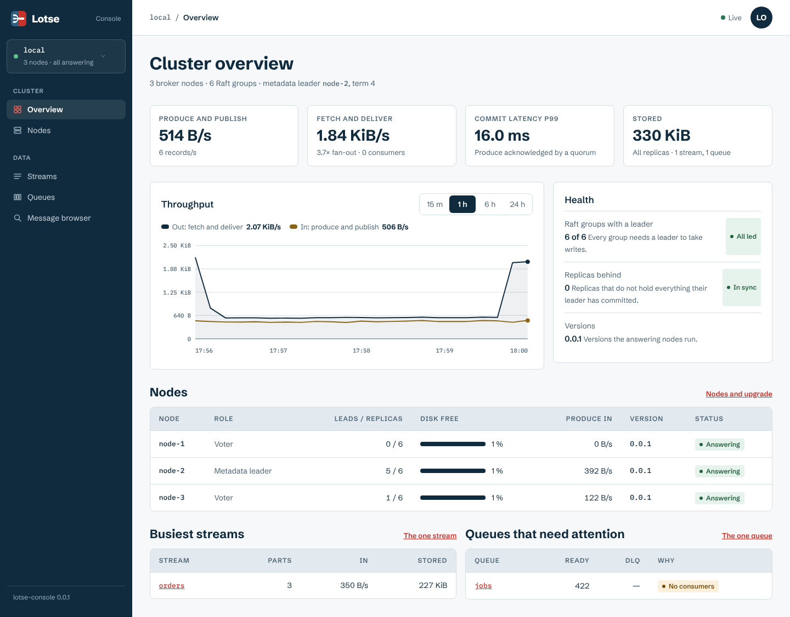
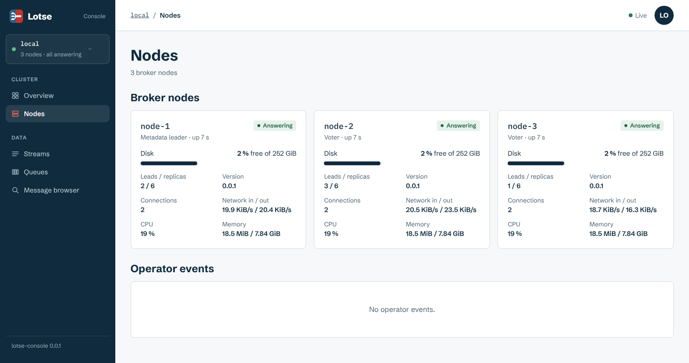

# Management console

`lotse-console` runs on a dedicated node and serves the web app from `console/web`. These screenshots show it against the built-in demo cluster (see the main README for how to run it).

| Page | |
| --- | --- |
| Cluster overview |  |
| Nodes and rolling upgrade |  |
| Streams |  |
| Stream detail |  |
| Queues |  |
| Queue detail |  |
| Message browser |  |
| Tenants and access |  |

## Against a real cluster

The same console in front of three nodes on localhost (`cargo run -p lotse-console --example local_cluster`): numbers come from `DescribeMetrics`, and what the cluster does not have yet (tenants, zones, disk limits, an operator) is left out or shown as `—`.

| Page | |
| --- | --- |
| Cluster overview |  |
| Nodes |  |

## Mockups

[`mockups/`](mockups/) holds the mockups the console was built from, one page per file, as made on a design canvas (`canvas.json` lays them out). They are HTML with template placeholders that a canvas runtime fills in, so they do not render on their own in a browser; read them as markup, or look at the screenshots above for what was built.

Styling follows the [brand](../brand/): tokens from [`tokens.json`](../brand/tokens.json), the same values as `console/web/src/styles.css`.
