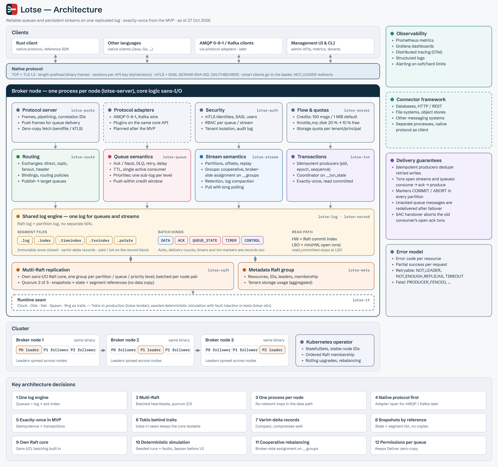

# Lotse – Architektur & Storage-Design



Oct 27, 2026 · @Pierre Jochem

## Überblick

Ein Enterprise-Message-Broker in Rust, der RabbitMQ-artige **Reliable Queues** und Kafka-artige **Persistent Streams** auf einer gemeinsamen Log-Engine betreibt, mit Exactly-once-Semantik ab dem MVP.

- **Reliable Queues:** Exchanges und Routing, Ack/Nack/Reject, DLQ, Retry und Delayed Delivery, TTL, Prioritäten, Prefetch, Single Active Consumer.
- **Persistent Streams:** partitionierte Logs, Consumer Groups, Replay über Offsets, Retention, Log Compaction.
- **Gemeinsamer Kern:** Security (TLS/mTLS, RBAC, Mandanten), Metadaten, Cluster-Steuerung, Metriken und Tracing.

Architekturprinzipien: Zuverlässigkeit vor Durchsatz, Failover ohne Datenverlust, sichere Defaults, Einfachheit statt unnötiger Komplexität. Connectors zu Datenbanken, HTTP und anderen Messaging-Systemen laufen als separate Prozesse.

## Architekturentscheidungen

Acht Grundentscheidungen sind getroffen. Sie bauen aufeinander auf: Die gemeinsame Log-Engine macht Multi-Raft und Exactly-once für beide Datenmodelle mit einer Implementierung möglich.

| # | Thema | Entscheidung | Begründung |
| --- | --- | --- | --- |
| 1 | Storage | Eine Log-Engine für Queues und Streams; Queues = Log + Ack-Index | Eine Storage- und Replikations-Engine statt zwei |
| 2 | Replikation | Multi-Raft: Raft pro Partition/Queue, gebündelte Heartbeats und Batching pro Node-Paar | Starke Garantien, skaliert auf tausende Queues |
| 3 | Laufzeit | Ein Broker-Prozess pro Node, Services als Module/Crates | Keine Netzwerk-Hops im Datenpfad |
| 4 | Protokolle | Natives Rust-Protokoll zuerst, Adapter-Layer vorgesehen; AMQP 0-9-1 und Kafka-Wire später als Plugins | Schlanker Start, bestehende Clients später nachrüstbar |
| 5 | Garantien | Exactly-once ab MVP: idempotente Producer + Transaktionen | Consume–Ack–Produce atomar über Queues und Streams |
| 6 | Runtime | Tokio | Ökosystem (rustls, openraft-Ideen, tonic), schnell produktiv |
| 7 | Record-Kodierung | Varint-Deltas (Kafka-Stil) | Kompakt, gut komprimierbar |
| 8 | Raft-Snapshots | State + Segment-Referenzen | Kein Kopieren unveränderlicher Segmente |

## Storage-Layout

Das Raft-Log **ist** das Partition-Log: Es gibt kein separates WAL, jeder Raft-Entry ist ein Record-Batch, und `base_offset` plus eins ist der Raft-Index des ersten Records. Ein Entry deckt so viele Indizes ab, wie er Records hat (first..=last); Index 0 bleibt so für „vor dem ersten Entry“ frei.

### Dateien pro Partition/Queue

```
partition-0007/
  00000000000000000000.log        # Record-Batches (Raft-Entries)
  00000000000000000000.index      # sparse: offset -> byte pos
  00000000000000000000.timeindex  # sparse: timestamp -> offset
  raft.state                      # term, voted_for, commit_index
  snapshot                        # Raft-Snapshot: Producer-, Txn- und Koordinator-State, State Machine
```

Geschlossene Segmente sind unveränderlich. Das ist die Grundlage für Snapshots per Referenz und für den Segment-Rewrite.

### Batch-Header (fest, little-endian)

```rust
struct BatchHeader {
    base_offset:       u64,  // = Raft-Index des ersten Records − 1
    batch_len:         u32,
    term:              u64,  // Raft-Term (Leader-Epoch)
    magic:             u8,
    crc32c:            u32,  // ab `attributes` bis Batch-Ende
    attributes:        u16,  // compression(3) | txn(1) | control(1) | kind(3)
    last_offset_delta: u32,
    base_ts:           i64,
    max_ts:            i64,
    producer_id:       u64,  // 0 = nicht idempotent
    producer_epoch:    u16,
    base_sequence:     i32,
    record_count:      u32,
}
```

`kind` unterscheidet `DATA`, `ACK`, `QUEUE_STATE` und `TIMER`. Dadurch liegen Queue-Zustände im selben Log und in derselben Raft-Gruppe wie die Nachrichten.

### Record-Kodierung (varint-Deltas)

```
length          varint   // Länge des restlichen Records
attributes      i8       // reserviert
ts_delta        varlong  // relativ zu base_ts
offset_delta    varint   // relativ zu base_offset
key_len         varint   // -1 = null
key             bytes
value_len       varint   // -1 = null (Tombstone für Compaction)
value           bytes
header_count    varint
  [h_key_len varint, h_key bytes, h_val_len varint, h_val bytes]*
```

Komprimiert (zstd oder lz4, laut `attributes`) wird nur der Record-Block. Der Header bleibt immer unkomprimiert, damit Raft, Indizes und Transaktionslogik nie dekomprimieren müssen.

## Transaktionen & Exactly-once

Transaktionsmarker sind gewöhnliche Batches mit `control=1` und `txn=1`. Consumer lesen standardmäßig nur committete Daten (read committed).

### Control-Batches

Genau ein Record pro Marker:

```
key:   version u16 | type u16  (0 = ABORT, 1 = COMMIT)
value: coordinator_epoch u32
```

Ein Marker schließt alle offenen Batches derselben `producer_id` in dieser Partition ab.

### Producer-State und Idempotenz

Pro `producer_id` werden gehalten: Epoch, die letzten 5 Einträge `(base_seq, last_seq, offset)` und `current_txn_first_offset`.

- Duplikat mit bekannter Sequenz → alter Offset wird zurückgegeben.
- Lücke in der Sequenz → `OutOfOrderSequence`.
- Ältere Epoch → `ProducerFenced`.

Ein Producer, den die Partition nicht kennt, wird mit jeder Sequenz angenommen: Er ist neu oder wurde verdrängt (siehe unten), und dann lässt sich ein Retry nicht mehr erkennen.

Der Leader prüft gegen das **ganze Log**, nicht nur gegen das Committete: gegen den angewendeten Producer-State und gegen das Ende des Logs, das angehängt, aber noch nicht angewendet ist. So erkennt er auch einen Retry, dessen Original noch unterwegs ist, auf ihm selbst oder nach einem Leaderwechsel auf dem neuen Leader. Ein solches Duplikat wird beantwortet, sobald der Commit des Originals entscheidet. Das Log-Ende wird beim Start aus dem Log neu aufgebaut und beim Truncate mit abgeschnitten.

Jede Partition hält höchstens `max_producers` Producer (Standard 10.000, auf allen Nodes gleich). Kommt beim Anwenden einer mehr hinzu, fällt der Producer heraus, dessen letzter Schreibvorgang im Log am weitesten zurückliegt. Die Regel hängt nur am Log, also verdrängen alle Replicas dieselben Producer.

Der angewendete Producer-State ist Teil des Raft-Snapshots der Replica, neben den Daten der State Machine, und reist mit ihm zu Followern; Recovery replayt nur das Log nach dem Snapshot. (Das ersetzt die `.pstate`-Dateien beim Segment-Roll; ADR 0028.)

Producer-IDs vergibt die Koordinator-Gruppe: `InitProducer` schlägt dort einen Allokations-Entry vor, und sobald er nach derselben Regel wie ein `Produce` committet ist, ist die ID sein Raft-Index. Indizes werden nie wiederverwendet, also auch IDs nicht. Idempotente Producer bekommen Epoch 0; Epochs kommen mit transaktionalen IDs. Bis die Metadaten-Gruppe existiert, legt die Node-Konfiguration die Koordinator-Gruppe fest.

`lotse-client` produziert standardmäßig idempotent: Er nummeriert Batches pro Partition, schickt pro Partition einen nach dem anderen und wiederholt einen unbekannten Ausgang mit derselben Sequenz. Bleibt der Ausgang bis zum Ende der Retry-Zeit unbekannt, meldet er `Unknown` und beginnt mit einer neuen Producer-ID, damit spätere Batches nicht hinter einer Lücke warten, die sich vielleicht nie füllt.

### Lesepfad: HW und LSO

- **High Watermark (HW)** = Raft-Commit-Index, von der Mehrheit bestätigt.
- **Last Stable Offset (LSO)** = min(HW, `first_offset` aller offenen Txns).
- `read_committed`-Consumer lesen bis LSO und überspringen abgebrochene Batches anhand der Liste, die `Fetch` mitliefert, ohne das Log zu scannen. Die Replica hält offene Transaktionen und abgebrochene Bereiche im Speicher und im Raft-Snapshot (ADR 0029). Der LSO liegt nie hinter dem angewendeten Index: Darüber ist das Schicksal einer Transaktion hier noch nicht bekannt.

### Transaktions-Koordinator

Der Koordinator führt die interne Partition `__txn_state` als eigene Raft-Gruppe.

1. `InitProducer` vergibt `producer_id` und Epoch (Fencing alter Instanzen).
2. `AddPartitions` persistiert die Mitglieder der Transaktion.
3. `EndTxn` schreibt `PREPARE_COMMIT` (bzw. `PREPARE_ABORT`) in `__txn_state`.
4. COMMIT- bzw. ABORT-Marker gehen an jede beteiligte Partition (idempotent, mit Retry).
5. `COMPLETE_COMMIT` schließt die Transaktion ab.

Fällt der Koordinator nach `PREPARE_COMMIT` aus, schreibt der neue Leader die Marker zu Ende. Ein Timeout ohne `EndTxn` führt zu ABORT.

`__txn_state` ist die Koordinator-Gruppe aus ADR 0028. Jede Änderung einer transaktionalen ID ist ein Record mit ihrem ganzen neuen Zustand (Producer-ID, Epoch, Phase, Timeout, Partitionen), gespeichert als interner Control-Batch. Der Koordinator handelt erst, wenn sein Leader einen Entry seines eigenen Terms angewendet hat, und ändert pro transaktionaler ID immer nur eins; eine zweite Anfrage bekommt so lange `CONCURRENT_TRANSACTIONS`. Ist bei `InitProducer` noch eine Transaktion offen, bricht der Koordinator sie mit erhöhter Epoch ab und antwortet `CONCURRENT_TRANSACTIONS`; der Client versucht es erneut. Der Timeout läuft auf der Uhr des Koordinator-Leaders und beginnt bei einem Leaderwechsel neu.

**Das Ende einer Transaktion erhöht die Epoch.** `PREPARE_COMMIT` und `PREPARE_ABORT` tragen die Epoch plus eins, die Marker werden damit geschrieben, und `EndTxn` gibt sie zurück: Die nächste Transaktion läuft mit der neuen Epoch. Eine Partition schließt eine offene Transaktion nur mit einem Marker höherer Epoch als ihre Daten. So kann ein verspätet wiederholter Marker nie die nächste Transaktion schließen (die Lücke, die Kafka mit KIP-890 geschlossen hat). Jeder Marker trägt außerdem die Koordinator-Epoch (den Raft-Term der Koordinator-Gruppe); ältere als eine schon gesehene weist die Partition mit `COORDINATOR_FENCED` ab.

Die Marker schreibt der Koordinator-Node über den internen API-Key `WriteTxnMarkers`, mit demselben Client-Code wie jeder andere: Leader-Routing, `NOT_LEADER` und die Commit-Regel gelten unverändert. Ein Partition-Leader hängt einen Marker nur an, wenn er eine offene Transaktion schließt oder die Epoch des Producers erhöht; sonst ist nichts mehr zu tun. Das erhöhte Epoch-Fencing trifft so auch Partitionen, in die ein Zombie-Producer nie geschrieben hat. `COMPLETE_COMMIT` bzw. `COMPLETE_ABORT` schreibt der Koordinator erst, wenn jede Partition geantwortet hat.

## Queue-Semantik auf dem Log

Eine Queue ist ein Log plus Ack-Index. Acks, Zustellzähler und Timer sind selbst Records im selben Log, also repliziert und transaktionsfähig.

- **ACK-Batches** enthalten Offset-Ranges `[from, to)`, varint-kodiert (Key leer). Jede Replica wendet sie auf einen Ack-Index an: die **erledigten** Offsets als zusammengefasste Bereiche plus Ack-Floor (alles darunter ist erledigt). Erledigt ist ein Offset, wenn seine Nachricht bestätigt oder verworfen ist, zu einer abgebrochenen Transaktion gehört oder er gar keine Nachricht ist. Bereiche statt Roaring-Bitmaps (ADR 0031): Bestätigte Offsets bilden wenige lange Läufe. `Produce` nimmt nur Daten-Batches an, kein Client kann einen Ack schreiben.
- **Consume → Ack → Produce atomar:** Der Ack wird mit `txn=1` und der `producer_id` des Consumers geschrieben und greift erst mit dem COMMIT-Marker. Bei ABORT wird die Nachricht wieder zustellbar.
- **In-flight-Zustellungen** sind flüchtiger Leader-State. Nach einem Failover wird alles Unbestätigte neu zugestellt. Das ist korrekt, weil nur committete Acks zählen. Ein neuer Leader stellt erst zu, wenn er einen Eintrag seines eigenen Terms angewendet hat: Dann ist jeder vorher committete Ack angewendet, und eine bestätigte Nachricht geht nie wieder hinaus. Zugestellt wird nur unterhalb des LSO, Nachrichten offener Transaktionen warten. Hält eine Subscription eine Nachricht länger als den Ack-Timeout der Queue (Standard 30 Minuten, wie RabbitMQs Consumer-Timeout), endet sie mit `ACK_TIMED_OUT`, und ihre Nachrichten gehen an andere.
- **Zustellversuche für DLQ** werden nur bei Nack oder Timeout persistiert, jeweils bevor die Nachricht erneut hinausgeht, gebündelt als `QUEUE_STATE`-Record, nicht bei jeder Zustellung. Nach einem Disconnect zählt der Leader nur im Speicher weiter, nach einem Failover kann der Zähler neu beginnen: Er ist eine Untergrenze.
- **TTL und Delayed Delivery** nutzen `TIMER`-Records mit Fälligkeitszeit. Im Speicher steckt eine Timer-Wheel, die bei Recovery aus Snapshot und Log neu aufgebaut wird.

Prioritäten und Single Active Consumer: siehe Weitere Entscheidungen.

## Replikation & Snapshots

Jede Partition und jede Queue ist eine eigene Raft-Gruppe. Heartbeats und Append-Requests aller Gruppen zwischen zwei Nodes werden gebündelt (Multi-Raft). Eine Schreiboperation ist bestätigt, sobald 2 von 3 Replikaten sie persistiert haben.

### Snapshot-Inhalt

```
snapshot-<last_index>-<term>/
  manifest      // last_index, term, Membership,
                // Segmente (Name, base_offset, Größe, crc)
  pstate        // Producer-State inkl. offener Txns
  queue_state   // erledigte Offsets (Bereiche), Delivery-Counts, Timer-Wheel
```

- **Segmente werden nicht kopiert.** Das Manifest referenziert sie nur. Das ist sicher, weil geschlossene Segmente unveränderlich sind.
- **Follower-Catch-up:** Erst das Manifest, dann nur fehlende oder abweichende Segmente (crc), dann der State. Danach normale Replikation ab `last_index + 1`.
- **Log-Truncation:** Raft darf Einträge bis `last_index` verwerfen. Segmente löscht ausschließlich die Retention. Ein Snapshot pinnt seine Segmente, bis ein neuerer existiert.

Im Raft-Kern ist ein Snapshot nur `(index, term, membership)`; Inhalt und Übertragung gehören dem Server. Hat der Leader die Einträge kompaktiert, die ein Follower braucht, schickt er `Snapshot`, und der Server hängt seinen neuesten Snapshot an. Ein Follower, dessen Log den letzten Eintrag des Snapshots schon mit gleichem Term enthält, behält sein Log und committet nur: Einträge danach können bestätigte Kopien committeter Einträge sein. Erst ein abweichendes Log wird durch den Snapshot ersetzt.

Cluster-Metadaten (Topics, Queues, Partition-Zuordnung, Membership) liegen in einer eigenen Metadaten-Raft-Gruppe (ADR 0034), die jeder Node repliziert. Jede Admin-Änderung ist ein `Metadata`-Record; IDs kommen aus seinem Raft-Index (Ressource `2^40 + Index`, Partition `p` als Gruppe `2^40 + Index · 4096 + p`), konfigurierte IDs sind klein und kollidieren nie. Der Metadaten-Leader wählt für jede neue Gruppe `replication` Voter (die Nodes mit den wenigsten Gruppen, bei Gleichstand die kleinere ID) und schreibt sie in den Record; jeder Node öffnet nur die Gruppen, deren Voter er ist. Ein Name existiert höchstens einmal: Ein Create für einen vorhandenen Namen ändert beim Anwenden nichts, der Leader antwortet nach dem Anwenden mit `NONE` nur, wenn der Name genau die ID dieses Records trägt, sonst mit `RESOURCE_EXISTS` und der ID des Gewinners. In der Node-Konfiguration festgelegte Streams, Queues und Exchanges bleiben daneben bestehen; Laufzeit-Bindings gelten auch für konfigurierte Exchanges. Eine Partition, die ein Node nicht hostet, beschreibt `Metadata` mit Leader 0 und ihren Votern; der Client fragt einen Voter nach dem Leader.

Gelöscht werden nur zur Laufzeit angelegte Ressourcen (ADR 0035); konfigurierte kämen beim nächsten Start zurück und werden mit `INVALID_REQUEST` abgelehnt. Ein `Delete`-Record entfernt die Ressource und hinterlässt einen Grabstein: ihre ID und die Zahl ihrer Gruppen. IDs werden nie wiederverwendet, also sagt der Grabstein für immer, dass ID und Gruppen weg sind. Jeder Node schließt die Gruppen, sobald seine Metadaten-Replica den Grabstein angewendet hat, und löscht ihre Dateien; da Laufzeit-Gruppen nur aus dem Metadaten-Zustand geöffnet werden und der Grabstein vor dem Löschen dauerhaft ist, öffnet ein Node, der mittendrin stehen bleibt, die Gruppe nie wieder und räumt nach dem Neustart fertig auf. Bindings gehen mit der gelöschten Queue oder dem Exchange, ein später angewendetes Bind auf eine gelöschte Seite ändert nichts. Wartende Anfragen und Queue-Subscriptions enden mit `UNKNOWN_RESOURCE`, und für eine gelöschte ID antwortet jeder Node `UNKNOWN_RESOURCE` statt `NOT_LEADER`. Der Transaktions-Koordinator schreibt keine Marker mehr in eine gelöschte Partition, damit die Transaktion endet. Der Name ist danach frei und bekommt beim nächsten Anlegen eine neue, höhere ID; der Client nimmt bei abweichenden Antworten die höchste. Ändern lässt sich bisher nur das Ack-Timeout einer Queue (`ack.timeout.ms`, setzen oder auf den Standard zurück); `DescribeConfigs` nennt zu jedem Wert seine Quelle (Standard, zur Laufzeit gesetzt, Konfiguration) und wird wie die Änderungen vom Metadaten-Leader aus seinem angewendeten Zustand beantwortet.

### Membership-Änderungen

Neue Replikas kommen als **Learner** dazu: Sie erhalten das Log, stimmen aber nicht ab und zählen nicht zum Quorum. Erst wenn ein Learner aufgeholt hat, wechselt die Gruppe per **Joint Consensus** über die Konfiguration C\_old,new zu C\_new; während des Übergangs braucht jede Entscheidung eine Mehrheit in beiden Konfigurationen. So lassen sich auch mehrere Replikas auf einmal tauschen, etwa bei einer Rack-Migration. Konfigurationen sind eigene Entries im Log und gelten ab dem Anhängen, nicht erst ab dem Commit.

- **Eine Änderung zur Zeit:** Eine neue Änderung beginnt erst, wenn die vorige committet ist. Neue Voter müssen Learner sein, die bis zum Commit-Index aufgeholt haben. Den Schritt von C\_old,new zu C\_new hängt der Leader selbst an, sobald C\_old,new committet ist.
- **Neue Mitglieder beginnen von vorn:** Der Leader repliziert an sie ab dem Snapshot bzw. ab Index 1, nicht ab seinem Log-Ende.
- **Ein entfernter Leader** führt die Gruppe weiter, bis C\_new committet ist, und tritt dann zurück.
- **Wahlen während des Übergangs:** Ein Knoten, den die neueste, noch nicht committete Konfiguration entfernt, darf weiter kandidieren, wenn er in der vorigen Voter war. Er hat oft das längste Log, und ohne ihn kann es sein, dass niemand gewinnt. Er zählt Stimmen nach der neuesten Konfiguration. Ist die Entfernung committet, kandidiert er nicht mehr.
- **Keine Filterung von Stimmen nach Mitgliedschaft:** Ein zurückliegender Voter kennt einen eben beförderten Voter vielleicht noch nicht und muss ihn trotzdem wählen können. Störungen durch entfernte Knoten verhindert Leader-Stickiness: **Check-Quorum ist deshalb immer an** und nicht abschaltbar; Pre-Vote bleibt konfigurierbar.

### Linearisierbare Lesezugriffe

Standard ist **ReadIndex**: Der Leader merkt sich seinen Commit-Index, bestätigt per Heartbeat-Runde mit einem Quorum, dass er noch Leader ist, und antwortet, sobald dieser Index angewendet ist. Gleichzeitige Lesezugriffe teilen sich eine Runde. **Leader-Leases** sind pro Cluster zuschaltbar, wo die Uhrenabweichung begrenzt ist; dann liest der Leader ohne Runde, solange seine Lease läuft.

- **Runden:** Jedes Append und jeder Heartbeat trägt eine Rundennummer (`seq`), die der Follower zurückgibt. Ein Lesezugriff gilt als bestätigt, sobald ein Quorum eine Runde beantwortet hat, die **nach** seinem Eintreffen gesendet wurde; eine frühere Runde beweist die Führung nur für die Zeit davor. Alle Lesezugriffe zwischen zwei `Ready` teilen sich eine Runde.
- **Neuer Leader:** Lesezugriffe warten, bis er einen Eintrag seines eigenen Terms committet hat; vorher kann sein Commit-Index zurückliegen.
- **Abgebrochen:** Tritt der Leader zurück, meldet er offene Lesezugriffe als abgebrochen; der Client fragt beim neuen Leader nach. Follower lesen nicht selbst, der Server leitet an den Leader weiter.
- **Lease:** Mit `lease_ticks` liest der Leader ohne Runde, solange ein Quorum eine Runde beantwortet hat, die vor weniger als `lease_ticks` gestartet wurde. Die Lease muss um mehr als die Uhrenabweichung kürzer sein als das Election-Timeout. Ein neu gestarteter Knoten ignoriert dann ein Election-Timeout lang Stimmanfragen, weil er einen Leader mit laufender Lease vergessen haben kann.

### Leader-Transfer

`transfer_leadership(ziel)` nimmt keine Schreibzugriffe mehr an (Clients werden an das Ziel verwiesen), bringt das Ziel auf den neuesten Stand und schickt ihm `TimeoutNow`. Das Ziel kandidiert sofort ohne Pre-Vote; seine Stimmanfragen tragen ein Transfer-Kennzeichen, das die Leader-Stickiness übergeht. Kommt in einem Election-Timeout kein Wechsel zustande, führt der Leader weiter. Ein Leader, der in seinem Term einen Transfer versucht hat, verzichtet für den Rest des Terms auf die Lease: Ein verzögertes `TimeoutNow` könnte das Ziel sonst noch während einer laufenden Lease an die Macht bringen.

## Retention & Compaction

Gelöscht wird immer segmentweise. Streams und Queues unterscheiden sich nur darin, wann ein Segment frei wird.

- **Streams:** Retention nach Zeit oder Größe. Compaction behält den letzten Wert pro Key; ein `null`-Value ist ein Tombstone. Control-Batches bleiben erhalten, bis alle Daten ihrer Transaktion entfernt sind.
- **Queues:** Ein Segment ist löschbar, sobald der Ack-Floor darüber liegt.
- **Segment-Rewrite:** Eine einzelne, lange unbestätigte Nachricht würde sonst Segmente festhalten. Der Rewrite kopiert die Überlebenden in ein neues Segment, behält Original-Offsets und `QUEUE_STATE` bei. Der nächste Snapshot referenziert die neuen Segmente, danach werden die alten freigegeben.

## Natives Protokoll

TCP mit TLS, eigenes längenpräfixiertes Binärformat, Version pro API-Key. Record-Batches gehen unverändert vom Log auf die Leitung.

| Thema | Entscheidung |
| --- | --- |
| Transport | TCP + TLS 1.3, eigenes Framing, Multiplexing über Correlation-IDs |
| Kodierung | Eigenes Binärformat (feste Felder + varints), Tagged Fields für Erweiterungen |
| Versionierung | Min/max-Version pro API-Key, im Handshake gemeldet; Client wählt pro Request |
| Authentifizierung | mTLS für Service-Identitäten; SASL mit SCRAM-SHA-512 und OAUTHBEARER (OIDC) |
| Zustellung | Streams: Pull (Fetch mit Long-Polling); Queues: Push innerhalb eines Credit-Fensters |
| Cluster-Routing | Smart Client: Metadaten holen, direkt zum Leader; sonst `NOT_LEADER` mit Leader-Hinweis |

### Frames

```
Request:  length u32 | api_key u16 | api_version u16 | correlation_id u32
          | flags u16 | tagged_fields | body
Response: length u32 | correlation_id u32 | flags u16 | tagged_fields | body
Push:     length u32 | api_key u16 | api_version u16 | correlation_id 0
          | flags PUSH | subscription_id u32 | body
```

Requests auf einer Verbindung werden gepipelined; Antworten kommen pro Partition geordnet, aber nicht global. Push-Frames (Zustellung an Queue-Consumer) nutzen `correlation_id = 0` und tragen die Subscription-ID.

Das Längenfeld ist das des Transports: Eine `Net`-Verbindung trägt ganze Frames, auf TCP mit `u32`-Präfix, und der Codec beginnt danach. Eine Antwort, deren Body nur aus einem Fehlercode besteht (der Request ließ sich gar nicht bedienen, etwa `UNSUPPORTED_VERSION`), setzt das Flag `ERROR` (2).

### Verbindungsaufbau

1. TLS-1.3-Handshake (rustls, ohne Session-Resumption). Eine CA, die des Clusters, bürgt für alles. Auf Client-Links prüft der Client Kette und Hostnamen des Servers; ein angebotenes Client-Zertifikat liefert den Principal (Common Name). Node-Links verlangen auf beiden Seiten ein Node-Zertifikat mit der URI lotse://node/\<id>; geprüft wird die Kette, nicht der Hostname, dafür nimmt ein Node Frames nur von einem Mitglied seiner Konfiguration an, von jedem nur in eigenem Namen, und sendet erst, wenn das Zertifikat den gemeinten Node nennt (ADR 0037). Klartext-TCP gibt es nur auf Loopback und nur auf ausdrückliche Wahl; eine Runtime ohne beides verweigert das Netz.
2. `ApiVersions`: Broker meldet min/max je API-Key und seine Features.
3. `SaslHandshake` + `SaslAuthenticate` mit SCRAM-SHA-512 oder OAUTHBEARER (entfällt mit Client-Zertifikat, wenn mtls an ist). Verlangt der Node Authentifizierung, beantwortet er vorher alles außer ApiVersions mit UNAUTHORIZED; ein Fehlschlag wird mit AUTHENTICATION\_FAILED beantwortet und schließt die Verbindung. SCRAM-Credentials (Salt, Iterationen, StoredKey, ServerKey, nie das Passwort) liegen in der Metadaten-Gruppe und werden mit AlterUser gesetzt; jeder Node prüft gegen seinen angewendeten Stand. Tokens prüft der Node gegen die Schlüssel des Issuers, die er über die Naht Http holt und zwischenspeichert; eine unbekannte Key-ID löst höchstens alle 30 s einen neuen Abruf aus. Die Authentifizierung läuft im Task der Verbindung, die Hauptschleife sieht nur Anfragen samt Principal (ADR 0038).
4. Eine Session endet nach max\_session (Standard 1 h), mit Token spätestens mit dessen Ablauf; der Client authentifiziert sich nach vier Fünfteln erneut auf derselben Verbindung, ohne den Principal wechseln zu können.

### Mandanten und Rollen

Jede Ressource gehört zu einem Mandanten (Tenant). Mandanten legt ein Cluster-Admin ausdrücklich an und löscht sie (`CreateTenant`, `DeleteTenant`); ein Mandant mit Ressourcen lässt sich nicht löschen. Den Mandanten `default` gibt es immer, die Konfiguration kann weitere nennen und konfigurierten Ressourcen zuordnen. Namen bleiben clusterweit eindeutig.

Fünf Rollen: cluster-admin (alles, auch Benutzer, Mandanten und Bindungen), tenant-admin (Ressourcen im Mandanten anlegen, ändern, löschen, binden und alles darunter), producer (schreiben), consumer (lesen, Queues, Consumer-Gruppen), viewer (sehen). Eine Bindung gibt eine Rolle einem Benutzer oder einer Gruppe des Identity Providers (aus dem Groups-Claim des Tokens), in einem Mandanten, für die Ressourcen, deren Name mit einem Präfix beginnt. Bindungen liegen in der Metadaten-Gruppe (`AlterRoleBindings`, `DescribeRoleBindings`), `WhoAmI` nennt die eigenen; Bootstrap-Admins stehen in der Konfiguration.

Jeder Node prüft jede Anfrage gegen die Bindungen, die er angewendet hat, bevor er sie bedient. Fehlt die Rolle, lehnt er sie als Ganzes mit `UNAUTHORIZED` und einer Begründung ab; was ein Principal nicht sehen darf, ist ihm unbekannt (`Metadata`, `DescribeTenants`, `DescribeMetrics`). Ein Node darf als Client nur Metadaten lesen und Transaktionsmarker schreiben, und nur Nodes dürfen Marker schreiben. Ob ein Mandant existiert, prüft der Metadaten-Leader beim Vorschlagen; das Anwenden verweigert nur Anlagen in einem inzwischen gelöschten Mandanten und hängt so nie von der Konfiguration eines Nodes ab (ADR 0039).

### API-Keys (erster Schnitt)

| Bereich | API-Keys |
| --- | --- |
| Cluster | `ApiVersions`, `Metadata`, `FindCoordinator` |
| Streams | `Produce`, `Fetch`, `ListOffsets`, `GroupHeartbeat`, `CommitOffsets`, `OffsetFetch` |
| Queues | `Publish`, `Subscribe`, `Deliver` (Push), `Credit`, `Ack`, `Nack`, `Unsubscribe` |
| Transaktionen | `InitProducer`, `AddPartitionsToTxn`, `AddAcksToTxn`, `AddOffsetsToTxn`, `EndTxn` |
| Admin | `CreateStream`, `CreateQueue`, `DeclareExchange`, `Bind`, `DeleteResource`, `DescribeConfigs`, `AlterConfigs`, `Unbind`, `DescribeMetrics` |

`Publish` routet über Exchanges und schreibt in die Ziel-Queues. Im ersten Schritt routet der Client (ADR 0032): `Metadata` liefert Typ und Bindings eines Exchanges samt der gebundenen Queues, der Client wählt die Queues mit `lotse-route` und schreibt per `Produce` in jede, idempotent pro Queue. Ohne Transaktion gilt jede Queue für sich wie bei RabbitMQ (der Fehler nennt, welche Queues die Nachricht haben), in einer Transaktion alle oder keine. Exchanges und Bindings stehen bis zur Metadaten-Gruppe in der Node-Konfiguration. `Produce` schreibt direkt in eine Partition. Beide nutzen dasselbe Batch-Format und dieselben Idempotenzregeln.

Die API-Keys sind in der Reihenfolge der Tabelle nummeriert: `ApiVersions` 0, `Metadata` 1, `FindCoordinator` 2, `Produce` 3, `Fetch` 4 und so weiter bis `InitProducer` 16, `AddPartitionsToTxn` 17, `EndTxn` 20, `CreateStream` 21 bis `AlterConfigs` 27; `Unbind` ist 28, `DescribeMetrics` 29. Interne Keys zwischen Nodes beginnen bei 1000 (`WriteTxnMarkers` 1000). Alle beginnen bei Version 0. Umgesetzt sind bisher `ApiVersions`, `Metadata`, `FindCoordinator`, `Produce`, `Fetch`, `GroupHeartbeat`, `CommitOffsets`, `OffsetFetch`, `Subscribe`, `Deliver`, `Credit`, `Ack`, `Nack`, `Unsubscribe`, `InitProducer`, `AddPartitionsToTxn`, `AddOffsetsToTxn`, `EndTxn`, `CreateStream`, `CreateQueue`, `DeclareExchange`, `Bind`, `Unbind`, `DeleteResource`, `DescribeConfigs`, `AlterConfigs`, `DescribeMetrics` und `WriteTxnMarkers` (ADR 0026, 0028, 0029, 0031, 0033, 0034, 0035, 0036).

### Zero-copy

`Fetch` sendet Segmentbytes ohne Umkodierung. Ohne TLS über `sendfile`, mit TLS über kTLS (Linux), sonst über einen gepufferten Pfad. Bei `read_committed` endet die Antwort am LSO; der Client filtert abgebrochene Batches anhand der mitgelieferten Liste.

## Flow Control & Quotas

Überlast wird gebremst, nicht abgebrochen: Throttle-Zeiten in Antworten, Hard-Stop nur für Schreibvorgänge. Lesen und Acks laufen immer weiter, damit sich Queues leeren können.

| Thema | Entscheidung |
| --- | --- |
| Consumer-Credits (Queues) | Fenster aus Nachrichtenanzahl **und** Bytes; Nachschub über `Credit` |
| Publisher-Backpressure | `throttle_ms` in jeder Antwort; ignoriert der Client es, hält der Broker die Verbindung für diese Zeit an |
| Disk-/Speicherknappheit | Soft-Grenze: `throttle_ms` steigt; Hard-Grenze: Schreiben → `STORAGE_FULL`, Lesen/Acks weiter |
| Quota-Ebene | Mandant als Obergrenze, darunter optional pro Principal/Client-ID (nur enger, nie weiter) |
| Begrenzte Ressource | Speicher (Bytes gesamt inkl. Replikate) |
| Überschreitung | Schreiben → `QUOTA_EXCEEDED`; Lesen und Acks weiter |
| Erfassung | Partition-Leader melden Nutzung alle paar Sekunden an die Metadaten-Gruppe; Durchsetzung lokal, kurzes Überschreiten möglich |

Nach dem MVP folgen Durchsatz-Quotas (Bytes/s rein und raus) sowie Quotas für Verbindungen und Request-Rate, beide über denselben `throttle_ms`-Mechanismus. Quotas auf die Anzahl von Ressourcen sind nicht geplant.

## Feldlayouts der API-Keys

Datenpfad-Requests adressieren Ressourcen nur über u64-IDs aus `Metadata`. Jede Partition oder Queue in einer Antwort trägt ihren eigenen Fehlercode, sodass Teilerfolge möglich sind.

### Konventionen

```
u8/u16/u32/u64/i64  feste Breite, little-endian
varint              ZigZag-varint
string              u16 Länge + UTF-8 (0xFFFF = null)
bytes               u32 Länge + Daten
array<T>            varint Anzahl + Elemente
tagged_fields       array{tag varint, bytes} am Ende jeder Struktur, für abwärtskompatible
                    Erweiterungen; unbekannte Tags werden übersprungen
```

Ein Frame ist standardmäßig höchstens 16 MiB groß (konfigurierbar), ein Record-Batch höchstens 1 MiB. Der Broker prüft `length` vor dem Lesen des Bodys und schließt bei Überschreitung mit `FRAME_TOO_LARGE`.

### Cluster

```
ApiVersions  -> versions: array{api_key u16, min u16, max u16}, features: array<string>

Metadata     <- names: array<string>            // leer = alle
             -> brokers:   array{node_id u32, host string, port u16, rack string}
                resources: array{error u16, name string, resource_id u64,
                                 kind u8,       // STREAM | QUEUE | EXCHANGE
                                 partitions: array{partition u32, leader u32,
                                                   leader_term u64, voters array<u32>},
                                 exchange: {type u8,   // DIRECT | TOPIC | FANOUT | HEADERS
                                            bindings: array{queue_id u64, binding_key string,
                                                header_match: array{key bytes, value bytes?},
                                                match_all u8}}?}
```

Eine Queue erscheint als Ressource mit genau einer Partition 0.

```
FindCoordinator <- key_type u8,          // 0 = GROUP, 1 = PRODUCER
                   key string             // Gruppenname oder transaktionale ID, sonst leer
                -> error u16, node_id u32, host string, port u16, error_msg string?
```

### Streams

```
Produce  <- txn_id string?, timeout_ms u32,
            resources: array{resource_id u64, partitions: array{partition u32, batch bytes}}
         -> throttle_ms u32,
            resources: array{resource_id u64, partitions: array{partition u32, error u16,
                       base_offset u64, append_ts i64, error_msg string?}}

Fetch    <- max_wait_ms u32, min_bytes u32, max_bytes u32,
            isolation u8,                       // 0 = uncommitted, 1 = committed
            resources: array{resource_id u64, partitions: array{partition u32,
                       fetch_offset u64, leader_term u64, max_bytes u32}}
         -> throttle_ms u32,
            resources: array{resource_id u64, partitions: array{partition u32, error u16,
                       high_watermark u64, last_stable_offset u64, log_start_offset u64,
                       aborted_txns: array{producer_id u64, first_offset u64},
                       records bytes}}          // rohe Segmentbytes, zero-copy
```

Eine Partition mit `NOT_LEADER` trägt als Tag 0 `{leader u32, term u64}`.

**Wann `Produce` antwortet.** Der Leader schlägt jeden Batch vor und antwortet, sobald das Ergebnis endgültig ist: geschrieben, wenn der Index des Batches **auf diesem Node** committet ist und dort den Term trägt, in dem er vorgeschlagen wurde; nicht geschrieben (`NOT_LEADER`), wenn der committete Entry dort einen anderen Term hat. Committete Entries ändern sich nie, deshalb ist diese Antwort endgültig. Wird der Entry auf diesem Node ersetzt, bevor er committet ist, meldet der Leader **keinen** Fehler: Ein anderer Node kann ihn noch haben und später committen (mit fünf Voters ist das möglich). Sieht der Node den Commit nicht innerhalb von `timeout_ms`, lautet die Antwort `REQUEST_TIMED_OUT`, Ausgang unbekannt.

**Was `Fetch` liefert.** Nur der Leader bedient Fetches, und nie einen Batch ab seinem Commit-Index (der High Watermark). Ein neuer Leader kennt den Commit-Index erst, wenn ein Entry seines Terms committet ist; seine High Watermark kann also kurz hinter Offsets liegen, die ein Client schon gelesen hat. Deshalb heißt `OFFSET_OUT_OF_RANGE` vor dem Log-Start oder hinter dem Log-Ende des Leaders; dazwischen wartet der Fetch auf Daten.

Bis die Metadaten-Gruppe existiert, kommen Streams und die Raft-Gruppe jeder Partition aus der Node-Konfiguration. `lotse-client` wiederholt einen `Produce` mit unbekanntem Ausgang nicht, solange es keine idempotenten Producer gibt; er wiederholt nur, was sicher nicht geschrieben wurde.

### Consumer Groups

```
GroupHeartbeat <- group_id string, member_id string,      // leer beim Beitritt
                  member_epoch i32,                       // 0 = beitreten, -1 = verlassen
                  rebalance_timeout_ms u32,
                  subscribed array<u64>?,                 // nur bei Änderung
                  owned: array{resource_id u64, partitions array<u32>}?  // nur bei Änderung
               -> throttle_ms u32, error u16, member_id string, member_epoch i32,
                  heartbeat_interval_ms u32,
                  assignment: array{resource_id u64, partitions array<u32>}?
                                                          // vollständig, nur bei Epoch-Wechsel

OffsetFetch    <- group_id string, require_stable u8,     // 1 = auf offene Txn-Commits warten
                  resources: array{resource_id u64, partitions array<u32>}
               -> resources: array{resource_id u64, partitions: array{partition u32, error u16,
                             offset u64, leader_term u64, metadata string?}}

CommitOffsets  <- group_id string, member_id string, member_epoch i32,
                  resources: array{resource_id u64, partitions: array{partition u32,
                             offset u64, leader_term u64, metadata string?}}
               -> resources: array{resource_id u64, partitions: array{partition u32, error u16}}
```

Der Koordinator ist der Leader der `__groups`-Partition, auf die die Gruppe gehasht wird (`FindCoordinator`). Im ersten Schritt (ADR 0033) ist das die Koordinator-Gruppe, die auch Transaktionen koordiniert. Die Mitgliedschaft wird persistiert: Jede Änderung einer Gruppe ist ein `GroupState`-Record mit der ganzen Gruppe (Epoch, je Member Subscription, Member-Epoch, Ziel-, zugewiesene und abzugebende Partitionen), committete Offsets sind `GroupOffsets`-Records; beides liegt im Snapshot der Koordinator-Gruppe. Ein Member gibt Partitionen erst frei, wenn seine Antwort sie nicht mehr enthält; der Koordinator vergibt sie erst neu, wenn der alte Besitzer sie im nächsten Heartbeat nicht mehr als `owned` meldet oder entfernt ist. So hat eine Partition nie zwei Besitzer. Entfernt wird ein Member, wenn eine Session lang kein Heartbeat kam, oder wenn es eine entzogene Partition nicht im Rebalance-Timeout abgibt, aber nie früher als eine Session nach dem Entzug; der Client gibt alles ab, sobald eine Session lang kein Heartbeat gelungen ist, gerechnet ab dem Senden des letzten erfolgreichen. Neue Fehlercodes: 15 `FENCED_MEMBER_EPOCH` (neu beitreten), 16 `UNKNOWN_MEMBER_ID` (neu beitreten), 17 `FRAME_TOO_LARGE` (Verbindung wird geschlossen), 24 `UNSTABLE_OFFSET_COMMIT` und 25 `CONCURRENT_GROUP_CHANGE` (beide wiederholbar).

**Exactly-once mit Offsets in der Transaktion.** `AddOffsetsToTxn` (19) trägt die Offsets selbst: `txn_id string, producer_id u64, producer_epoch u16, group_id string, member_id string, member_epoch i32, resources` wie bei `CommitOffsets`, Antwort wie `CommitOffsets`. Der Koordinator nimmt sie nur von einem Member an, das jede Partition noch hält; ein Zombie wird abgewiesen, seine Transaktion kann nur noch abbrechen. Die Offsets warten im Zustand der Transaktion und werden zu committeten Offsets der Gruppe, sobald ihr `PREPARE_COMMIT` angewendet ist. Marker brauchen sie nicht, weil sie in derselben Raft-Gruppe liegen; `PREPARE_ABORT` verwirft sie. Solange eine Transaktion einen Offset hält, antwortet `OffsetFetch` mit `require_stable` mit `UNSTABLE_OFFSET_COMMIT`: Ein neuer Besitzer wartet das Ergebnis ab.

### Queues

```
Publish     <- txn_id string?, timeout_ms u32,
               entries: array{exchange_id u64, routing_key string, mandatory u8, batch bytes}
            -> throttle_ms u32,
               entries: array{error u16, routed: array{queue_id u64, base_offset u64}}

Subscribe   <- queue_id u64, consumer_tag string, credit_msgs u32, credit_bytes u32,
               exclusive u8
            -> error u16, subscription_id u32

Deliver     (Push, correlation_id 0)
               subscription_id u32, error u16, batch bytes,
               deliveries: array{offset u64, delivery_count u16}

Credit      <- subscription_id u32, add_msgs u32, add_bytes u32   // flag NO_RESPONSE

Ack         <- queue_id u64, txn_id string?, ranges: array{from u64, to u64}
            -> error u16

Nack        <- queue_id u64, ranges: array{from u64, to u64}, requeue u8, delay_ms u32
            -> error u16
```

`Deliver` sendet den Batch unverändert aus dem Log. `deliveries` nennt die Records daraus, die diesem Consumer zugestellt sind; bereits bestätigte oder anderen Consumern zugestellte Records im selben Batch ignoriert der Client.

### Transaktionen

```
InitProducer       <- txn_id string?, txn_timeout_ms u32
                   -> error u16, producer_id u64, producer_epoch u16

AddPartitionsToTxn <- txn_id string, producer_id u64, producer_epoch u16,
                      resources: array{resource_id u64, partitions array<u32>}
                   -> resources: array{resource_id u64, partitions: array{partition u32, error u16}}

AddAcksToTxn       <- txn_id string, producer_id u64, producer_epoch u16, queue_ids array<u64>
                   -> queues: array{queue_id u64, error u16}

EndTxn             <- txn_id string, producer_id u64, producer_epoch u16, commit u8
                   -> error u16, producer_id u64, producer_epoch u16   // Epoch für die nächste Transaktion

WriteTxnMarkers    <- markers: array{producer_id u64, producer_epoch u16, commit u8,       // intern, Key 1000
                                     coordinator_epoch u32,
                                     resources: array{resource_id u64, partitions array<u32>}}
                   -> markers: array{producer_id u64,
                                     resources: array{resource_id u64, partitions: array{partition u32, error u16}}}
```

### Admin

Admin-APIs laufen über das native Protokoll, mit derselben Authentifizierung und Versionierung; `lotse-cli` nutzt sie direkt. Ein REST/JSON-Gateway für die Management-UI folgt nach dem MVP.

```
CreateStream    <- name string, partitions u32, replication u8, configs: array{key string, value string}
                -> error u16, resource_id u64, error_msg string?
CreateQueue     <- name string, priority_levels u8,       // 1–10, je Stufe ein Sub-Log
                   single_active u8, dlq string?, replication u8,
                   configs: array{key string, value string}   // ack.timeout.ms
                -> error u16, resource_id u64, error_msg string?
DeclareExchange <- name string, kind u8,                  // DIRECT | TOPIC | FANOUT | HEADERS
                   configs: array{key string, value string}
                -> error u16, resource_id u64, error_msg string?
Bind            <- exchange_id u64, queue_id u64, binding_key string,
                   header_match: array{key bytes, value bytes?}, match_all u8
                -> error u16
Unbind          <- wie Bind -> error u16
DeleteResource  <- resource_id u64, if_empty u8 -> error u16, error_msg string?
DescribeConfigs <- resource_ids array<u64>
                -> error u16,
                   resources: array{resource_id u64, error u16,
                               configs: array{key string, value string, source u8}}   // DEFAULT | DYNAMIC | STATIC
AlterConfigs    <- resource_id u64, set: array{key string, value string}, delete array<string>
                -> error u16, error_msg string?
DescribeMetrics <- (leer)                                   // an jeden Node einzeln
                -> error u16, node_id u32, version string, uptime_ms u64,
                   metadata_group u64, coordinator_group u64, connections u64,
                   client_in u64, client_out u64, peer_in u64, peer_out u64,   // Bytes seit Start
                   commit_latency array<u64>,               // Bucket i: unter 2^i ms, der letzte: langsamer
                   host{cpu ‰?, memory?, memory_limit?, disk_free?, disk_total?},
                   partitions: array{group, resource_id, partition, leader u8, term, high_watermark,
                                     last_stable, log_start, log_end, size_bytes, produce_bytes,
                                     produce_records, fetch_bytes, replicas: array{node_id, log_end}},
                   queues: array{resource_id, ready, in_flight, in_open_txns, delivered, acked,
                                 consumers: array{subscription_id, peer, in_flight, credit}},
                   groups: array{group_id, epoch, members: array{member_id, owned}, offsets}
```

Antworten mit `NOT_LEADER` tragen als Tag 0 den Leader der Metadaten-Gruppe. Umgesetzt sind `CreateStream`, `CreateQueue`, `DeclareExchange`, `Bind` und `Unbind` (ADR 0034) sowie `DeleteResource`, `DescribeConfigs` und `AlterConfigs` (ADR 0035); Prioritäten, Single Active Consumer, Dead-Letter-Queues, Stream-Settings und `if_empty` lehnt der Leader mit `INVALID_REQUEST` ab, ebenso jede Änderung außer `ack.timeout.ms` einer Queue.

### Fehlercodes

| Code | Name | Retry | Bedeutung |
| --- | --- | --- | --- |
| 0 | `NONE` | – | Erfolg |
| 1 | `NOT_LEADER` | ja | Falscher Node; Leader-ID und Term als Tagged Field |
| 2 | `FENCED_LEADER_TERM` | ja | Client-Term veraltet; Metadata neu laden |
| 3 | `UNKNOWN_RESOURCE` | nein | ID existiert nicht (mehr) |
| 4 | `OFFSET_OUT_OF_RANGE` | nein | Offset vor Log-Start oder hinter dem Log-Ende des Leaders |
| 5 | `NOT_ENOUGH_REPLICAS` | ja | Kein Quorum erreichbar |
| 6 | `REQUEST_TIMED_OUT` | ja | Quorum-Bestätigung nicht innerhalb `timeout_ms` |
| 7 | `OUT_OF_ORDER_SEQUENCE` | nein | Lücke in der Producer-Sequenz |
| 8 | `PRODUCER_FENCED` | nein | Neuere Producer-Epoch aktiv |
| 9 | `INVALID_TXN_STATE` | nein | Operation passt nicht zum Txn-Zustand |
| 10 | `QUOTA_EXCEEDED` | später | Speicherkontingent des Mandanten erreicht |
| 11 | `STORAGE_FULL` | später | Hard-Grenze des Nodes erreicht |
| 12 | `CORRUPT_BATCH` | nein | CRC oder Format ungültig |
| 13 | `UNAUTHORIZED` | nein | RBAC verweigert |
| 14 | `UNSUPPORTED_VERSION` | nein | API-Version außerhalb min/max |
| 18 | `COORDINATOR_NOT_AVAILABLE` | ja | Keine Koordinator-Gruppe konfiguriert oder gerade ohne Leader |
| 19 | `CONCURRENT_TRANSACTIONS` | ja | Eine andere Änderung derselben Transaktion läuft |
| 20 | `COORDINATOR_FENCED` | nein | Ein neuerer Koordinator hat die Marker dieses Producers übernommen |
| 21 | `INVALID_REQUEST` | nein | Die Anfrage ist ungültig, etwa ein Ack für Offsets hinter dem Log-Ende |
| 22 | `UNKNOWN_SUBSCRIPTION` | nein | Die Subscription gibt es auf dieser Verbindung nicht (mehr) |
| 23 | `ACK_TIMED_OUT` | nein | Die Subscription hielt eine Nachricht länger als den Ack-Timeout; sie ist beendet, nur in Pushes |
| 24 | `UNSTABLE_OFFSET_COMMIT` | ja | Eine offene Transaktion hält einen noch nicht committeten Offset der Partition |
| 25 | `CONCURRENT_GROUP_CHANGE` | ja | Eine andere Änderung derselben Consumer-Gruppe läuft |
| 26 | `RESOURCE_EXISTS` | nein | Eine Ressource dieses Namens existiert schon; die Antwort nennt ihre ID |

## Weitere Entscheidungen

Der Broker heißt **Lotse**. Raft wird selbst implementiert und von Anfang an über deterministische Simulation getestet.

| Thema | Entscheidung | Folge |
| --- | --- | --- |
| Prioritäten | Eigenes Sub-Log (eigene Raft-Gruppe) pro Prioritätsstufe unter einer Queue-ID, höchste nicht leere Stufe zuerst | Transaktionale Acks können mehrere Sub-Logs umfassen; der Koordinator behandelt sie wie Partitionen |
| Single Active Consumer | Leader-lokal: erster Subscriber ist aktiv, Übernahme bei Disconnect oder Credit-Timeout | Vor der Übergabe bricht der Leader offene Ack-Transaktionen des alten Consumers ab |
| Rebalancing | Kooperativ, Zuweisung durch den Broker (KIP-848-Stil) | `GroupHeartbeat` ersetzt `JoinGroup`, `SyncGroup` und `Heartbeat` |
| Group-Koordinator | Interne Partitionen `__groups`, Gruppen per Hash verteilt; Leader = Koordinator | Offset-Commits sind Records und laufen über `AddOffsetsToTxn` in Transaktionen |
| Raft-Implementierung | Eigener Raft-Kern: Partition-Log = Raft-Log, Batching nativ | Mehr Eigenaufwand, passt exakt zum Storage-Design |
| Tests | Deterministische Simulation (I/O, Uhr, Netz, Scheduler hinter Traits), Jepsen-artige Tests vor 1.0 | Tokio nur an den Rändern; `turmoil` oder `madsim` als Bausteine prüfen |
| Berechtigungen | Lesezugriff pro Queue bzw. Stream, nie pro Record | `Deliver` bleibt zero-copy |
| Schemas | Reservierter Header für die Schema-ID; Registry nach dem MVP | Keine Broker-seitige Validierung im MVP |
| Disk-Schwellen | Soft bei 20 % frei, Hard bei 10 % frei, pro Node konfigurierbar | Reserve für Snapshots und Segment-Rewrites |
| Credit-Fenster | Standard 100 Nachrichten / 1 MiB, pro `Subscribe` überschreibbar | – |
| Tiered Storage | Nach dem MVP; Snapshot-Manifest bekommt jetzt schon einen Speicherort pro Segment | Leader lädt geschlossene Segmente nach S3, `Fetch` liest Remote-Bereiche bei Bedarf |
| Kubernetes-Operator | Drain vor Entfernen: Leaderships verschieben, Ersatzreplikat per Joint Consensus, erst dann Pod/PVC löschen; nie zwei Membership-Changes pro Gruppe gleichzeitig | Rolling Upgrades in place: Leaderships wegverschieben, Pod mit gleicher Node-ID und gleichem PVC neu starten, Aufholen abwarten, dann der nächste Node |

## Crate-Struktur

Die Kernlogik ist sans-I/O: Raft, Log-Zustand, Transaktionen und Queue-Semantik sind reine Zustandsmaschinen ohne Tokio-Abhängigkeit. Nur `lotse-server` treibt sie an, und zwar über die Traits aus `lotse-rt`. Dadurch läuft derselbe Server-Code produktiv auf Tokio und im Test in der deterministischen Simulation.

| Ebene | Crate | Aufgabe | Darf abhängen von |
| --- | --- | --- | --- |
| Fundament | `lotse-rt` | Traits `Clock`, `Disk`, `Net`, `Spawn`, `Rng`, `Host` | – |
| Fundament | `lotse-rt-tokio` | Tokio-Implementierung von `rt`: Dateisystem mit Verzeichnis-`sync`, TCP mit Längenpräfix je Frame | `rt` |
| Fundament | `lotse-record` | Batch-Header, varint-Records, CRC32C, zstd/lz4 | – |
| Fundament | `lotse-proto` | Frames, API-Keys, Request/Response-Typen, Fehlercodes | `record` |
| Kern | `lotse-log` | Segmente, Indizes, `.pstate`, Snapshot-Manifest, Recovery | `rt`, `record` |
| Kern | `lotse-raft` | Raft-Zustandsmaschine pro Gruppe, Multi-Raft-Batching pro Node-Paar | `record` |
| Kern | `lotse-txn` | Producer-State, Idempotenz, LSO, Koordinator-Zustand | `record` |
| Domäne | `lotse-queue` | Ack-Index (Bereiche), Credits, DLQ, Timer-Wheel, Prioritäts-Sub-Logs, SAC | `record`, `txn` |
| Domäne | `lotse-stream` | Partitionen, Offsets, `__groups`, kooperative Zuweisung | `record`, `txn` |
| Domäne | `lotse-route` | Exchanges, Bindings, Routing-Policies | – |
| Domäne | `lotse-meta` | Metadaten-Zustand: Ressourcen, IDs, Leader, Quota-Nutzung | `raft` |
| Domäne | `lotse-auth` | mTLS-Principals, SASL, RBAC, Mandanten, Quotas | `proto` |
| Integration | `lotse-server` | Verbindungen, Dispatch, Raft-Treiber, Flow Control; generisch über `rt` | alle oben |
| Auslieferung | `lotse-broker` | Binary: Konfiguration, Start des Nodes auf `lotse-rt-tokio` | `server` |
| Auslieferung | `lotse-client` | Rust-SDK (Produce, Fetch, Publish, Subscribe, Txns) | `proto`, `record` |
| Auslieferung | `lotse-cli` | Admin-CLI | `client` |
| Test | `lotse-sim` | Simulations-`rt`, Cluster-Harness, Fault-Injection, Checker | `server`, `client` |

Adapter für AMQP 0-9-1 und Kafka kommen später als `lotse-amqp` und `lotse-kafka` hinzu. Sie hängen nur von `lotse-server` ab, nicht umgekehrt.

### Schnittstellen

```rust
// lotse-rt: die einzige Naht zur Außenwelt
pub trait Clock: Clone + Send + Sync + 'static {
    fn now(&self) -> Instant;
    fn sleep(&self, d: Duration) -> impl Future<Output = ()> + Send;
}

pub trait Disk: Clone + Send + Sync + 'static {
    type File: SegmentFile;
    fn open(&self, path: &Path, mode: OpenMode) -> impl Future<Output = io::Result<Self::File>> + Send;
    fn rename(&self, from: &Path, to: &Path) -> impl Future<Output = io::Result<()>> + Send;
    fn remove(&self, path: &Path) -> impl Future<Output = io::Result<()>> + Send;
    fn remove_dir(&self, dir: &Path) -> impl Future<Output = io::Result<()>> + Send; // leeres Verzeichnis
}

pub trait SegmentFile: Send + Sync + 'static {
    fn append(&self, buf: Bytes) -> impl Future<Output = io::Result<u64>> + Send;
    fn read_at(&self, pos: u64, len: usize) -> impl Future<Output = io::Result<Bytes>> + Send;
    fn sync(&self) -> impl Future<Output = io::Result<()>> + Send; // Sim: kann Daten "verlieren"
}

pub trait Net: Clone + Send + Sync + 'static { /* listen(addr, Link), connect(addr, Link), verifies_peers; Conn::peer_identity */ }
pub trait Spawn: Clone + Send + Sync + 'static { /* spawn, JoinHandle */ }
pub trait Rng: Clone + Send + Sync + 'static { fn next_u64(&self) -> u64; }
// Nur für Kennzahlen: CPU, Speicher, Platz auf dem Datenvolume; die Sim liefert feste Werte
pub trait Host: Send + Sync + 'static { fn host_stats(&self) -> impl Future<Output = HostStats> + Send; }

pub trait Runtime: Clock + Disk + Net + Spawn + Rng + Host {}
```

```rust
// lotse-raft: sans-I/O, vom Server getrieben
impl RaftGroup {
    pub fn new(cfg: Config, restored: Restored) -> Self; // HardState + Term-Runs + applied
    pub fn tick(&mut self);                              // logische Zeit; der Server tickt
                                                         // nach seiner Uhr aus lotse-rt
    pub fn step(&mut self, from: NodeId, msg: Message);  // eingehende Nachricht
    pub fn propose(&mut self, records: u64, data: Bytes)
        -> Result<(u64, u64), NotLeader>;                // belegte Indizes first..=last
    pub fn ready(&mut self) -> Ready;                    // in dieser Reihenfolge: HardState,
                                                         // truncate_from, Entries persistieren,
                                                         // committed anwenden, dann senden
    pub fn advance(&mut self);                           // letztes Ready ist durabel
}
// Ausgehende Appends tragen nur fill_from: der Server füllt die Entries
// aus seinem Log, damit der Kern keine Batches puffern muss.
// MultiRaft bündelt die Nachrichten aller Gruppen pro Zielknoten.
```

Der Server treibt jede Raft-Gruppe als `Replica` auf ihrem eigenen `lotse-log`. Ein `Ready` wird in dieser Reihenfolge persistiert: installierter Snapshot (Datei `snapshot`, State Machine wiederhergestellt, Log startet danach neu), Truncation, Entries mit anschließendem `sync`, **dann erst** der Hard State (`raft.state`), danach Anwenden und Senden. Der Hard State kommt zuletzt, weil sein Commit-Index auf das Log zeigt, das davor geschrieben wurde (ADR 0023). `raft.state` und `snapshot` werden atomar geschrieben: temporäre Datei, `sync`, Umbenennen. Data-Batches liegen so im Log, wie der Producer sie geschickt hat; No-Ops und Membership-Änderungen als Raft-Control-Batches. `Replica::open` baut alles aus der Disk wieder auf, auch nach einem Absturz mitten in einer Snapshot-Installation, und wendet committete Entries nach dem Snapshot erneut an.

Ein `Node` hostet viele Replicas hinter einem Transport. Seine Hauptschleife tickt alle Gruppen einmal pro Tick, führt Befehle aus, gibt eingegangene Nachrichten an ihre Gruppe, verarbeitet die `Ready` aller Gruppen und bündelt alle Nachrichten für einen Ziel-Node in einen Frame. Pro Ziel hält ein Sender eine ausgehende Verbindung und baut sie mit Backoff (ein Tick bis 50 Ticks) neu auf; solange das Ziel nicht erreichbar ist, behält seine Warteschlange die neuesten 256 Frames, denn Raft sendet Wichtiges ohnehin erneut. Verbindungen über `Net` tragen ganze Frames (höchstens 16 MiB) in Reihenfolge, bis sie abbrechen. Im Frame stehen Version, Absender und pro Nachricht Gruppe, Art und Inhalt; Entries reisen als die Batches, die im Log liegen, ohne neu kodiert zu werden. Ein Frame, der sich nicht dekodieren lässt, beendet die Verbindung (ADR 0025).

### Simulation

- `lotse-sim` implementiert `Runtime` mit einem Seed: virtuelle Uhr, Scheduler in einem Thread, Netz mit Verzögerung, Partitionen und Verbindungsabbrüchen, bei denen alles Unterwegs-Befindliche verloren geht; die Raft-Simulation verliert, verdoppelt und vertauscht zusätzlich einzelne Nachrichten.
- Die Disk-Simulation kennt Torn Writes, verlorene Daten seit dem letzten `sync` und Bitflips, die der CRC erkennen muss.
- Checker prüfen nach jedem Lauf: kein bestätigter Write geht verloren, keine doppelt sichtbaren Transaktionen bei `read_committed`, keine Ack-Verluste in Queues.
- Ein fehlgeschlagener Lauf ist über den Seed exakt reproduzierbar.
- Jeder simulierte Node hat eine eigene Disk. Ein Stromausfall lässt sich scharf schalten: Nach einer zufälligen Zahl von Schreiboperationen schlägt alles fehl, als sei der Prozess mittendrin gestorben; danach bleiben nur synchronisierte Daten plus ein zufälliger, eventuell zerrissener Rest. So trifft ein Absturz auch die Stellen zwischen zwei Schreibvorgängen eines `Ready`.

## Management-Console

Die Console läuft als eigenes Binary `lotse-console` auf einem dedizierten Node, getrennt von den Brokern. Der Browser spricht nur mit `lotse-console`; `lotse-console` spricht das native Protokoll mit dem Cluster, immer mit der Identität des angemeldeten Benutzers. Die Mockups liegen in [`console/mockups/`](console/mockups/), Screenshots der umgesetzten Console in [`console/`](console/).

```
Browser (React + TS + Radix)
   │  REST/JSON (OpenAPI) + 1 WebSocket, OIDC-Session
   ▼
lotse-console  (Rust, axum, dedizierter Node)
   │  natives Protokoll über lotse-client, SASL OAUTHBEARER mit dem Token des Benutzers
   ▼
Cluster A, Cluster B, …  (Broker-Nodes)
```

| Thema | Entscheidung |
| --- | --- |
| Backend | `lotse-console` in Rust (axum): liefert die gebaute React-App aus und stellt REST + WebSocket bereit; nutzt `lotse-client` |
| Identität | Login per OIDC (Authorization Code mit PKCE, state und nonce; ADR 0040). Die Session liegt in der Console hinter einem HttpOnly-Cookie, die Tokens erreichen den Browser nie; die Console erneuert das Access-Token per Refresh-Token und gibt es per SASL OAUTHBEARER an den Cluster. Für einen Rechner, den nur man selbst erreicht, gibt es den dev-Modus mit einem festen Benutzer und optional dessen SCRAM-Passwort. Je Principal hält die Console einen eigenen Client mit eigenen Messwerten, so zeigt jeder Bildschirm genau, was dessen Rollen erlauben. Broker-RBAC entscheidet, das Audit-Log zeigt den echten Benutzer, die Console hat selbst keine Admin-Rechte |
| Browser-API | REST/JSON, beschrieben mit OpenAPI (utoipa); der TypeScript-Client wird generiert (openapi-typescript). Das ist zugleich das geplante HTTP-Gateway |
| Live-Daten | Eine WebSocket-Verbindung mit Abos (Cluster-Übersicht, ein Stream, eine Queue). Die Console fragt pro Thema und Benutzer einmal beim Cluster nach und verteilt alle 2 s an alle Tabs dieses Benutzers. Weil jede Abfrage mit dem Token des Benutzers läuft, wächst die Last mit der Zahl der Benutzer pro Thema, nicht mit der Zahl der Tabs |
| Verlauf | Ringpuffer im Speicher, 24 h in 10-s-Schritten. Der Sampler läuft auch ohne angemeldete Benutzer und nutzt dafür als Einziges eine eigene, rein lesende Metrics-Identität der Console (Konfiguration: metrics.principal und metrics.password, SCRAM); seine Charts sieht jeder angemeldete Benutzer, sie braucht also eine Rolle, deren Sicht alle teilen dürfen. Längerer Verlauf und Alerting bleiben in Prometheus/Grafana, aus der UI verlinkt |
| Betrieb | Ein Console-Node verwaltet mehrere Cluster laut Konfiguration (Cluster-Umschalter). Außer dem Puffer zustandslos; ein Neustart kostet nur Chart-Verlauf. Ein Cluster ist echt (kind = native, über lotse-client an seinen Bootstrap-Adressen) oder der eingebaute Demo-Cluster (kind = demo). Was ein echter Cluster noch nicht kennt (Quotas, Zonen, Disk-Grenzen, Operator), lässt die UI weg oder zeigt es als —. Sessions liegen im Speicher: Ein Neustart meldet alle ab |

### Frontend

- React 18 + TypeScript, Radix Primitives, gestylt mit den Lotse-Tokens als CSS-Variablen (Hell und Dunkel).
- Radix-Zuordnung: Tabs (Stream-Bereiche), ToggleGroup (Zeitraum, Startpunkt), DropdownMenu (Cluster, Konto, Zeilenaktionen), Select (Tenant, Einheiten), Dialog (Queue anlegen), AlertDialog (Queue leeren), Switch (Committed only, Single active consumer), Progress (Upgrade), Tooltip, Toast, ScrollArea.
- Jede schreibende Aktion zeigt den gleichwertigen `lotse-cli`-Befehl, damit UI und CLI dieselben Operationen haben.

### Bildschirme

| Bildschirm | Zeigt | Wichtigste Aktionen |
| --- | --- | --- |
| Cluster-Übersicht | Durchsatz, p99-Commit-Latenz, Health, Nodes, auffällige Streams und Queues | Leader verschieben, zu Grafana |
| Stream | Partitionen mit Leader, Replikaten, HW und LSO; Consumer Groups mit Lag und kooperativer Zuweisung | Records lesen, Config ändern |
| Queue | Bereit, in Arbeit, in offenen Txns, Prioritätsstufen, Consumer mit Credits, SAC-Übergaben, Dead Letters | Requeue, Queue leeren |
| Message-Browser | Records eines Streams ab Offset oder Zeit, Txn-Status je Record, Header, Wert, Batch-Daten | Lesen ohne Consumer Group |
| Nodes | Rolling Upgrade Schritt für Schritt, Disk gegen Soft- und Hard-Grenze, Operator-Ereignisse | Upgrade pausieren, Leader verschieben |
| Tenants und Zugriff | Speicher gegen Quota je Tenant, Role Bindings je Principal | Quota ändern, Binding hinzufügen |

### Benutzergruppen

Gruppen kommen aus dem `groups`-Claim des Identity Providers und werden **im Broker** auf Rollen abgebildet, nicht in der Console. Da die Console mit der Identität des Nutzers handelt, gelten über `lotse-cli` dieselben Rechte; die Console blendet nur aus, was der Nutzer nicht darf. Metadaten sehen und Nachrichteninhalte lesen sind getrennte Berechtigungen.

| Gruppe | Bereich | Darf | Darf nicht |
| --- | --- | --- | --- |
| `lotse-platform-admins` | Cluster | Alles: Tenants, Quotas, ACLs, Knoten-Operationen, Upgrades | Nachrichteninhalte lesen, außer über eine Tenant-Gruppe |
| `lotse-operators` | Cluster | Alle Metadaten über Tenants hinweg; Leader verschieben, Knoten drainen, Upgrades, Throttling übersteuern; Break-Glass | ACLs oder Quotas ändern, Inhalte lesen, Daten löschen |
| `lotse-observers` | Cluster | Metadaten lesen: Übersicht, Knoten, Lag, Durchsatz | Jede Änderung, jeder Inhalt |
| `lotse-auditors` | Cluster | Principals, ACLs, Quotas und Audit-Log lesen | Daten und Operationen |
| `lotse-t-<tenant>-admin` | Tenant | Streams und Queues anlegen und löschen im Rahmen der Quota; eigene Principals und ACLs verwalten; Inhalte lesen | Eigene Quota erhöhen, andere Tenants |
| `lotse-t-<tenant>-developer` | Tenant | Streams und Queues anlegen und ändern, Offsets zurücksetzen, Dead-Letter-Queues requeuen oder purgen; Inhalte lesen außerhalb von Produktion | Streams löschen, ACLs verwalten, Inhalte in Produktion lesen |
| `lotse-t-<tenant>-support` | Tenant | Metadaten und Lag; Inhalte lesen, auch in Produktion; aus Dead-Letter-Queues requeuen | Purge, Offset-Reset, Anlegen oder Löschen |

Die Metrik-Identität (`metrics.principal`) ist ein Service-Account, keine Gruppe für Menschen.

- **Pro Cluster:** Dieselbe Gruppe kann je Cluster andere Rechte haben; Developer schreiben in Staging und lesen in Produktion nur Metadaten.
- **Inhalte in Produktion:** nur für `…-support` und `…-admin`, ohne Maskierung; jeder Zugriff auf Inhalte wird im Audit-Log festgehalten.
- **Destruktive Aktionen** (Purge, Offset-Reset, Löschen) sind eine eigene Berechtigung und verlangen in Produktion, den Ressourcennamen einzutippen.
- **Break-Glass ab v1:** Ein Operator erhebt sich mit Pflichtbegründung für höchstens 60 Minuten zum Admin. Das wird auditiert und als Banner auf der Übersicht gezeigt; danach fallen die Rechte von selbst zurück.
- **Audit:** Jeder Schreibzugriff wird festgehalten: wer, über welche Gruppe, in welchem Cluster, vorher und nachher.

**Rollen-Mapping:** Welche IdP-Gruppe welche Rolle bekommt, steht in den Cluster-Metadaten (`__meta`, per Raft repliziert) und wird über eine Admin-API geändert, aus `lotse-cli` und der Console. Damit gilt auf jedem Knoten dasselbe Mapping, und jede Änderung landet im Audit-Log. Die erste Admin-Gruppe legt `lotse-cli cluster init` an.

**Audit-Log:** Audit-Ereignisse gehen in den internen, replizierten Stream `__audit` mit eigener Retention. Jeder Eintrag enthält den Hash seines Vorgängers, sodass nachträgliche Änderungen auffallen. Ein Sink leitet den Stream an Syslog oder ein SIEM weiter. Auditoren lesen ihn in der Console.

**Kennzahlen:** Die Console holt ihre Kennzahlen über die Admin-API `DescribeMetrics` (ADR 0036), die jeder Node für sich selbst beantwortet: seinen Verkehr und seine Verbindungen, jede Raft-Gruppe, die er hält (Offsets, Log-Größe, Term, beim Leader der Fortschritt jedes Replikats), die Queues, die er führt (bereit, in Arbeit, in offenen Transaktionen, Consumer), als Leader der Koordinator-Gruppe die Consumer-Gruppen mit Mitgliedern und committeten Offsets, und über die Naht `Host` CPU, Speicher und das Datenvolume. Zähler laufen seit dem Start des Nodes und wachsen nur, eine Gruppe zählt nur bei ihrem Leader; die Console bildet Raten aus zwei Abfragen im Abstand von mindestens 5 s und die p99-Commit-Latenz aus einem Histogramm mit Zweierpotenz-Grenzen in ms. Fragt die Console alle Nodes, ist ein nicht antwortender Node als solcher sichtbar. `DescribeMetrics` zeigt jedem Principal nur, was er sehen darf; die eigenen Gruppen des Clusters sehen nur Cluster-Admins (ADR 0039). Zusätzlich soll jeder Knoten einen Prometheus-Endpunkt für Grafana und Alerting bieten; er ist für den Betrieb gedacht und nicht nach Tenants gefiltert.

### Crates und Ordner

- `crates/lotse-console`: axum-Server, OIDC, WebSocket-Fan-out, Ringpuffer; bettet die gebauten Web-Assets ins Binary ein.
- `console/web`: React-App; `npm run build` erzeugt die Assets, `npm run api` generiert den Client aus der OpenAPI-Datei von `lotse-console`.

## Offene Punkte

Die Designentscheidungen für Broker und Console sind getroffen. Offen für die Console:

- [x] Routing und Data-Fetching im Frontend: React Router, TanStack Query mit `openapi-fetch`
- [x] Welche Kennzahlen der Broker für die Console bereitstellt (Admin-API `DescribeMetrics` für die Console, Prometheus-Endpunkt je Node für den Betrieb)
- [x] OIDC-Login (Authorization Code mit PKCE) und Weitergabe des Tokens per OAUTHBEARER (ADR 0040)
- [ ] Admin-APIs für Purge, Requeue und Leader verschieben, danach die Buttons in der UI
- [ ] Einklappbares Menü auf dem Telefon

Umgesetzt sind `lotse-rt` mit `lotse-rt-tokio`, `lotse-record`, `lotse-queue`, `lotse-route`, `lotse-log`, `lotse-raft`, `lotse-proto`, `lotse-sim`, `lotse-server`, `lotse-client` und `lotse-console` mit `console/web`. Der Raft-Kern ist vollständig: optionales Pre-Vote, immer aktives Check-Quorum mit Leader-Stickiness, No-Op beim Leaderwechsel, Snapshots, Learner, Joint Consensus, Leader-Transfer, ReadIndex und optionale Leases. `lotse-server` hat `Replica`, eine Raft-Gruppe dauerhaft auf ihrem eigenen Log (atomare Zustandsdateien, `sync` vor jeder Bestätigung, Wiederherstellung beim Start), und `Node`, der viele Gruppen über einen Transport mit Bündelung pro Ziel-Node betreibt und Clients über das native Protokoll bedient (`ApiVersions`, `Metadata`, `FindCoordinator`, `Produce`, `Fetch`, `InitProducer`, `AddPartitionsToTxn`, `EndTxn`, intern `WriteTxnMarkers`, für Queues `Subscribe`, `Deliver`, `Credit`, `Ack`, `Nack`, `Unsubscribe`, für Consumer-Gruppen `GroupHeartbeat`, `CommitOffsets`, `OffsetFetch`, `AddOffsetsToTxn`, für die Verwaltung `CreateStream`, `CreateQueue`, `DeclareExchange`, `Bind`, `Unbind`, `DeleteResource`, `DescribeConfigs`, `AlterConfigs`, `DescribeMetrics`). `Produce` ist idempotent (ADR 0028) und transaktional über mehrere Partitionen (ADR 0029): Koordinator-Records in der Koordinator-Gruppe, Marker über das Protokoll, eine erhöhte Epoch pro Transaktion, LSO und abgebrochene Bereiche in der Replica, `read_committed` im Client. Queues funktionieren (ADR 0031): Acks und Zustellzähler als Batches im Log der Queue, in jeder Replica auf einen Ack-Index angewendet; der Leader stellt per Push im Credit-Fenster jeder Subscription zu, erst nach einem angewendeten Eintrag seines eigenen Terms und nur unterhalb des LSO; erneute Zustellung nach Nack, Disconnect, Failover und Ack-Timeout; Consumer im Client. Nachrichten lassen sich über Exchanges veröffentlichen (ADR 0032): Der Client routet nach den Bindings aus `Metadata` (direct, topic, fanout, headers) und schreibt in jede Ziel-Queue, pro Queue wie bei RabbitMQ oder in einer Transaktion alle oder keine. Consumer-Gruppen funktionieren (ADR 0033): Mitgliedschaft und Zuweisungen persistiert in der Koordinator-Gruppe, kooperatives Rebalancing, bei dem eine Partition nie zwei Besitzer hat, Offsets einfach oder in einer Transaktion committet für exactly-once Consume-Transform-Produce. Eine Metadaten-Gruppe legt Streams, Queues und Exchanges zur Laufzeit an und bindet Queues (ADR 0034); jede neue Gruppe läuft auf so vielen Nodes wie verlangt, konfigurierte Ressourcen bleiben. Zur Laufzeit angelegte Ressourcen lassen sich löschen, worauf jeder Node ihre Gruppen schließt und ihre Dateien entfernt, und das Ack-Timeout einer Queue lässt sich ändern und abfragen (ADR 0035). Derselbe `Node` läuft auf Tokio mit echter Disk und TCP und in der Simulation. Sieben Simulationen prüfen das, die CI fährt jede mit 5.000 Seeds, die Client-, die Queue- und die Metadaten-Simulation in eigenen Jobs pro Push mit 2.000 und nächtlich mit 5.000, die Gruppen-Simulation pro Push mit 1.000 (ADR 0027, 0030, 0031, 0033, 0034): die Raft-Simulation (Nachrichtenfehler, Partitionen, Uhren-Drift, Abstürze, Kompaktierung, Mitgliederwechsel, Führungsübergabe, linearisierbare Lesezugriffe), die Replica-Simulation mit Stromausfällen auch mitten in einem `Ready`, die Node-Simulation mit drei ganzen Nodes und drei Gruppen über das simulierte Netz, die Client-Simulation mit drei oder fünf Nodes, einem idempotenten, einem einfachen und einem transaktionalen Producer und zwei `read_committed`-Consumern über `lotse-client` und die Queue-Simulation mit zwei Queues, einem Topic- und einem Direct-Exchange, einem einfachen und einem transaktionalen Producer, die direkt oder über die Exchanges schreiben, und zwei Consumern, die bestätigen, zurückgeben, verwerfen, über den Ack-Timeout hängen und ihre Subscription aufgeben, sowie die Gruppen-Simulation mit drei Prozessoren einer Consumer-Gruppe, die einen Stream mit drei Partitionen in Transaktionen in einen zweiten schreiben, abstürzen, Zombies hinterlassen und über ihre Session hinaus stehen bleiben, und die Metadaten-Simulation, in der zwei Admin-Clients dieselben Ressourcen gleichzeitig anlegen, binden, ändern, löschen und neu anlegen, während ein Producer, ein Publisher und ein transaktionaler Producer sie benutzen. Sie prüfen, dass kein bestätigter Batch verloren geht oder wandert, dass Consumer nur Committetes lesen, dass ein als nicht geschrieben gemeldeter Batch tatsächlich fehlt, dass nichts doppelt im Log steht, dass jede committete Transaktion ganz, jede abgebrochene gar nicht und eine mit unbekanntem Ende ganz oder gar nicht sichtbar ist, und dass aus einer Queue keine Nachricht verloren geht, keine bestätigte wiederkommt und keine einer abgebrochenen Transaktion zugestellt wird, sowie dass eine veröffentlichte Nachricht genau in den Queues landet, die ihr Routing-Key wählt, dass jede bestätigte Eingabe der Gruppe genau einmal in der Ausgabe ankommt, und dass alle Nodes dieselben Ressourcen mit einer ID je Name kennen und jeder Node genau die Gruppen betreibt, deren Voter er ist, dass eine gelöschte Ressource nirgends mehr läuft, keine Dateien hinterlässt und überall unbekannt ist und dass eine Transaktion auf einer gelöschten Partition trotzdem endet; ein weiterer Simulationstest prüft, dass jeder Produce, Fetch, jede Zustellung und jedes Ack genau einmal und beim richtigen Node gezählt wird. Ein Test startet zusätzlich drei echte Nodes auf localhost, stoppt einen Leader und schreibt und liest über `lotse-client` weiter, ein zweiter stellt die Console vor drei echte Nodes und prüft ihre HTTP-API. Zusammen mit den Unit-Tests erkennen sie 18 eingebaute Raft-Fehler, alle 8 Durability-Fehler der Replica, alle 9 Transportfehler, alle 8 Protokollfehler, alle 11 Idempotenzfehler, alle 15 Transaktionsfehler, alle 11 Queue-Fehler, alle 6 Routing-Fehler, alle 8 Gruppen-Fehler, 6 von 7 Metadaten-Fehlern beim Anlegen und alle 13 beim Löschen und Ändern (unter anderem ein LSO, der offene Transaktionen übersieht oder dem Anwenden vorausläuft, Marker, die eine Transaktion gleicher Epoch schließen, ein Ende ohne Epoch-Erhöhung, ein Koordinator, der zwei Änderungen gleichzeitig zulässt, `COMPLETE` vor allen Markern, ein Client, der nach unbekanntem Schreibvorgang committet, ein neuer Queue-Leader, der vor seinem eigenen Term zustellt, eine Transaktion, die nach einem nur teilweise geschriebenen Publish committet, Offsets eines Zombies, ein ignoriertes `require_stable`). Der siebte Metadaten-Fehler, eine Antwort vor dem Commit, ist gleichwertig: Die Antwort hängt nur vom angewendeten Zustand ab. Die heikelsten fängt nur ein deterministischer Test, weil die Simulation die nötige Geschichte zu selten trifft. Drei echte Fehler wurden so gefunden: der Hard State vor dem Log (ADR 0023), ein zu enges `OFFSET_OUT_OF_RANGE` nach einem Leaderwechsel (ADR 0026) und ein `Metadata`-Decoder, der Bindings mit leerem Schlüssel ablehnte (ADR 0034). Die Console zeigt echte Cluster: Jeder Node beantwortet DescribeMetrics für sich selbst mit laufenden Zählern, einem Latenz-Histogramm und den Werten seines Hosts, die Console fragt alle Nodes und bildet daraus Raten (ADR 0036); daneben gibt es den eingebauten Demo-Cluster, und das Beispiel local\_cluster startet drei Nodes mit der Console. Jede Verbindung spricht TLS 1.3 mit Zertifikaten der Cluster-CA; Node-Links verlangen Node-Zertifikate auf beiden Seiten, Klartext nur auf Loopback (ADR 0037). Clients authentifizieren sich per Zertifikat, SCRAM-SHA-512 oder OAUTHBEARER mit Tokens des Identity Providers; Sessions enden, Clients erneuern sie (ADR 0038). Jede Ressource gehört zu einem Mandanten; fünf Rollen, gebunden an Benutzer oder IdP-Gruppen je Mandant und Namenspräfix, entscheiden über jede Anfrage (ADR 0039). Eine Zugriffs-Simulation ändert unter Last und Fehlern laufend Rollenbindungen und Passwörter und prüft, dass nichts gelingt, was keine Bindung erlaubte, und dass nach dem Heilen jeder Benutzer genau das darf, was die Bindungen erlauben; ihr Rollenmodell steht im Test selbst, unabhängig vom geprüften Code, die CI fährt sie pro Push mit 1.000 und nächtlich mit 5.000 Seeds. Die Console meldet Benutzer per OIDC an oder im dev-Modus mit SCRAM-Passwort und handelt je Principal mit einem eigenen Client (ADR 0040); ein Test prüft Anmeldung, Erneuerung, Abmeldung und abgelehnte ID-Tokens gegen einen echten Node mit Authentifizierung. Als Nächstes kommen Retention oder ein Node-Binary in Frage.
