# The management console

The console is a web app for looking at a cluster and, if your roles allow, changing it. It shows streams, queues, nodes and tenants, with live numbers and charts. It runs on a node of its own and talks to the cluster as you.

Ask your administrator for its address. The setup of the console itself is in the administration guide.

## Sign in

Users sign in with OpenID Connect at the identity provider the cluster trusts. On a development machine, the console may instead be in dev mode with one configured user and an optional password. The console passes your credential on to the cluster, so every screen shows only what your roles allow ([ADR 0040](https://github.com/pierrejochem/lotse/blob/main/docs/adr/0040-console-sign-in.md)). A queue you may not see is not listed. Sessions survive a console restart ([ADR 0042](https://github.com/pierrejochem/lotse/blob/main/docs/adr/0042-the-console-keeps-its-session-key.md)).

## Overview

The overview shows the cluster at a glance: nodes, groups, throughput and latency. Charts add up only the streams and queues you may see, and history gets coarser with age ([ADR 0045](https://github.com/pierrejochem/lotse/blob/main/docs/adr/0045-chart-history-coarser-with-age.md)). What a real cluster does not report yet, such as zones, disk limits or quotas, shows as a dash.

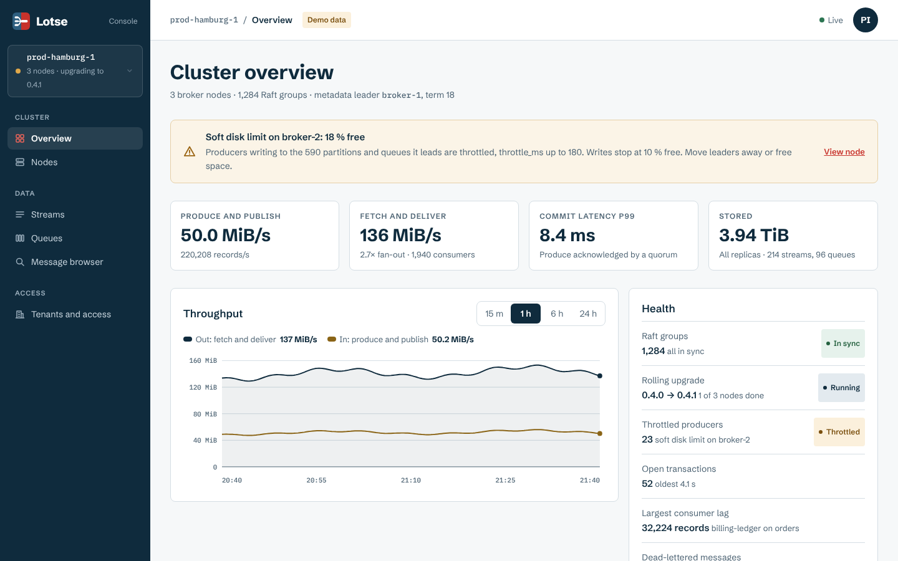

## Nodes

The nodes page lists each node with its state, replicas and leaders, and shows a rolling upgrade while one runs.

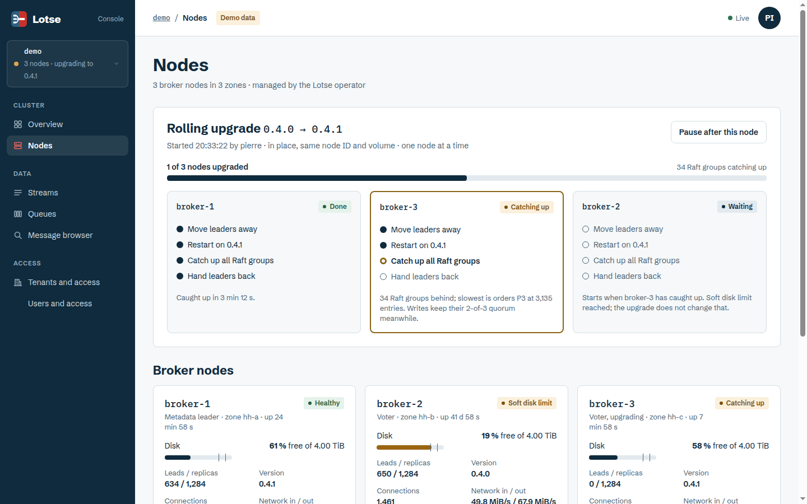

## Streams

The list shows each stream with its partitions, replication and rates. The detail page shows its partitions, where their leaders are, retention, and a message browser.

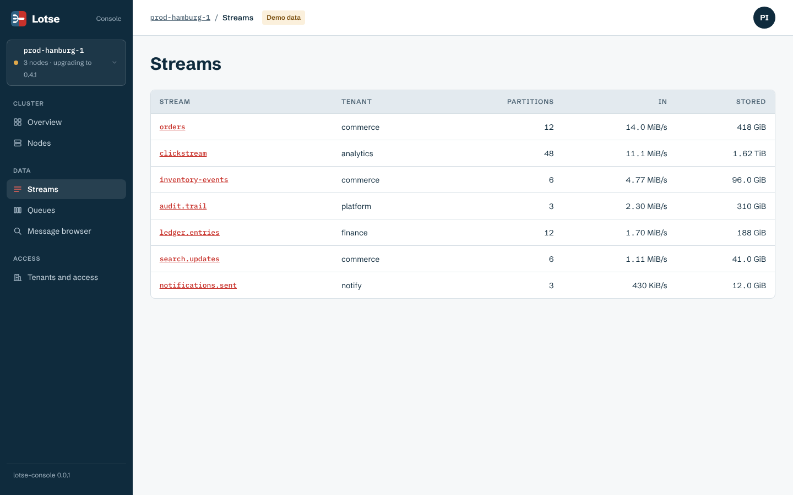

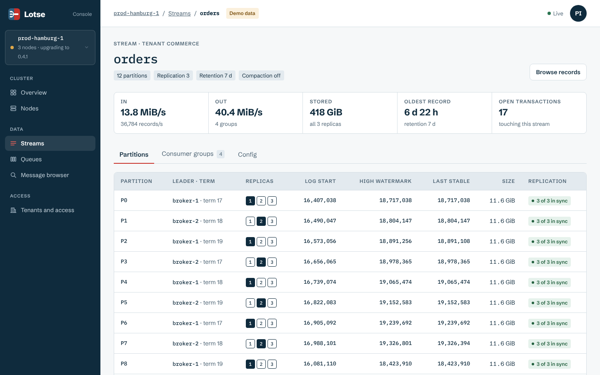

A cluster admin can pin a partition's leader to one of its voters from the detail page ("Pin to"). The spreading of leaders then leaves that partition alone ([ADR 0065](https://github.com/pierrejochem/lotse/blob/main/docs/adr/0065-pinned-leaders.md)).

## Queues

The list shows the messages per queue and how many were dead-lettered. The detail page shows tags for the queue's priority levels, single active consumer and dead-letter setting, the dead-lettered count, the dead letters held in the dead-letter queue, and charts.

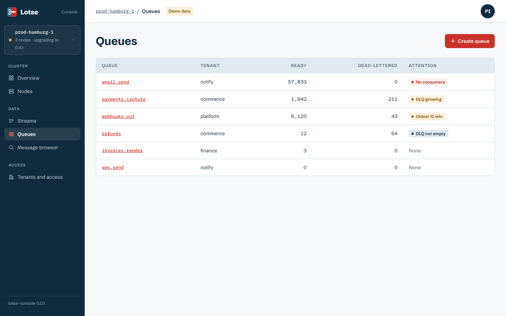

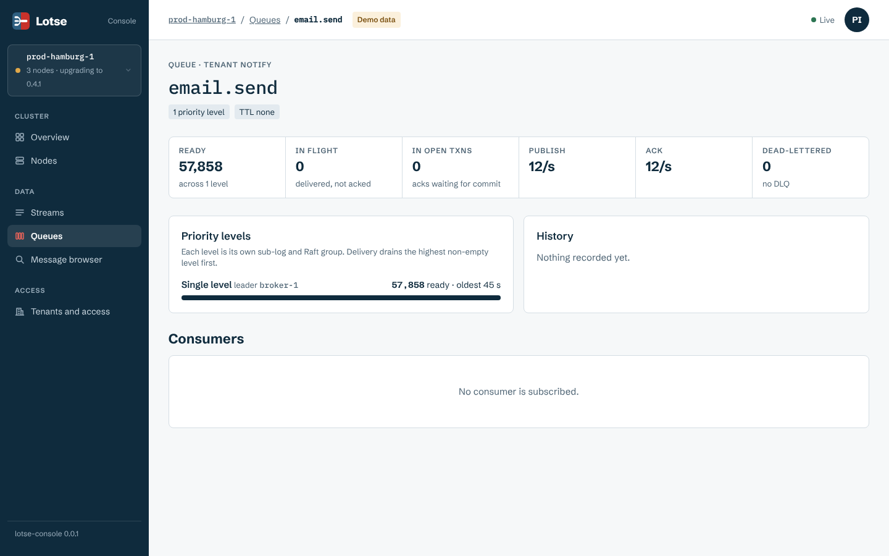

### Purge

**Purge** removes the ready messages of a queue. Messages a consumer holds, and messages in open transactions, stay. The console asks you to type the queue's name again before it acts. You need the tenant-admin role on the queue.

### Requeue

On a queue that is another queue's dead-letter queue, **Requeue all** moves its messages back to the queues they came from. A message moves once. Messages whose origin is unknown or gone stay where they are. Same role as for purge. Both actions are done as you ([ADR 0066](https://github.com/pierrejochem/lotse/blob/main/docs/adr/0066-console-actions.md), [ADR 0064](https://github.com/pierrejochem/lotse/blob/main/docs/adr/0064-purge-and-requeue.md)).

## Messages

The message browser shows messages of a stream or queue without taking them from it.

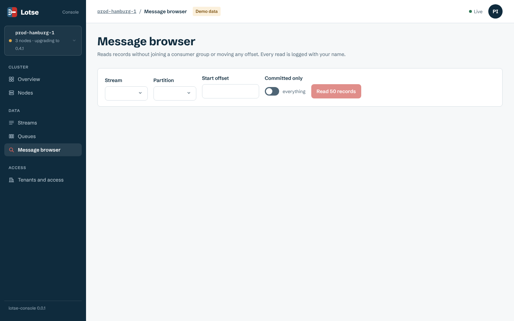

## Tenants and access

The tenant page lists tenants and the role bindings that apply to them: who holds which of the six roles, on which name prefix.

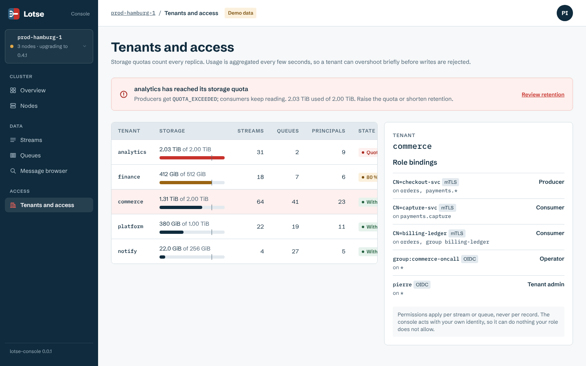

## Users and access

The *Users and access* page manages who may sign in and what they may do, as you: every change is a request the cluster checks against your roles, and the console adds no rights of its own ([ADR 0089](https://github.com/pierrejochem/lotse/blob/main/docs/adr/0089-console-users-and-access.md)). Only cluster admins can use it.

**Users** lists the SCRAM users and where each comes from. *Add user* and *Set password* turn the password into a salted key in your browser and send only the key; the console never sees the password. *Delete* asks you to type the name again.

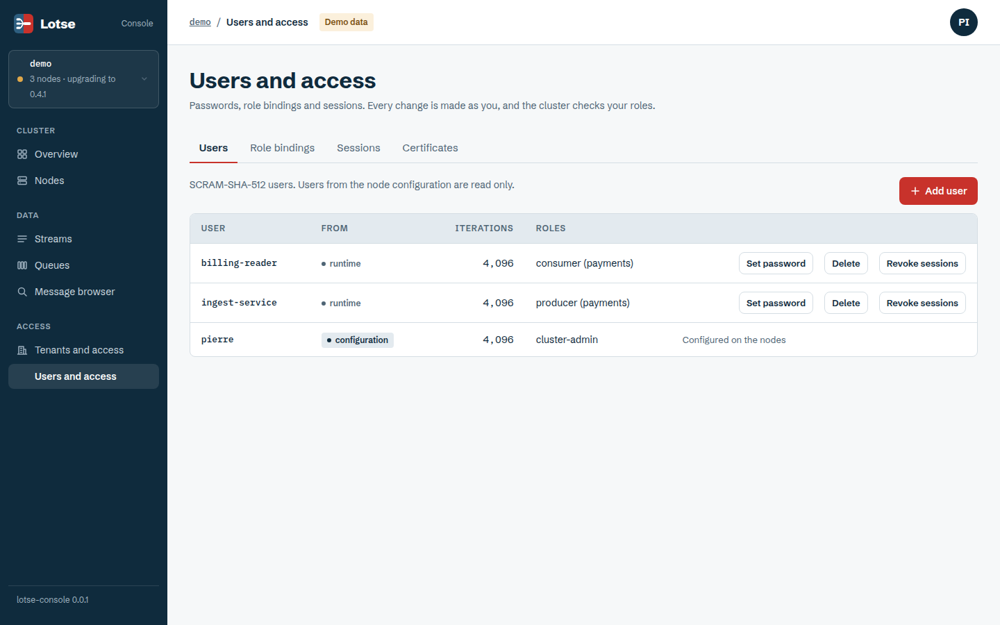

**Role bindings** shows every binding over all tenants with its source, and adds or removes bindings for users and identity provider groups. Bindings from the node configuration are read only.

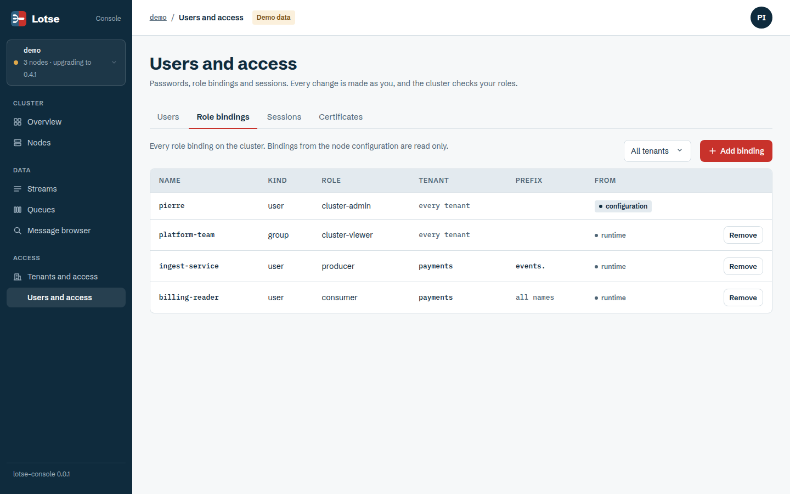

**Sessions** ends the sessions of a user or an identity provider group. Type the name again to confirm.

### Client certificates

**Certificates** lists the client certificates the nodes accepted, with the principal, when they expire and their state: valid, expiring within 30 days, expired or revoked. *Revoke* refuses a certificate on every node at once and ends the connections that showed it; type the serial again to confirm ([ADR 0090](https://github.com/pierrejochem/lotse/blob/main/docs/adr/0090-revoking-client-certificates-in-the-metadata-group.md), [ADR 0091](https://github.com/pierrejochem/lotse/blob/main/docs/adr/0091-client-certificate-inventory.md)).

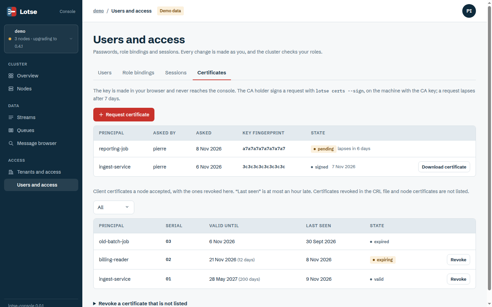

*Request certificate* asks the CA holder for a new client certificate. Your browser makes the key and the signing request; the private key is saved as a file once and never reaches the console. The CA holder signs the request with `lotse certs --sign`, and the signed certificate can then be downloaded from the list ([ADR 0092](https://github.com/pierrejochem/lotse/blob/main/docs/adr/0092-requesting-and-signing-client-certificates.md)).

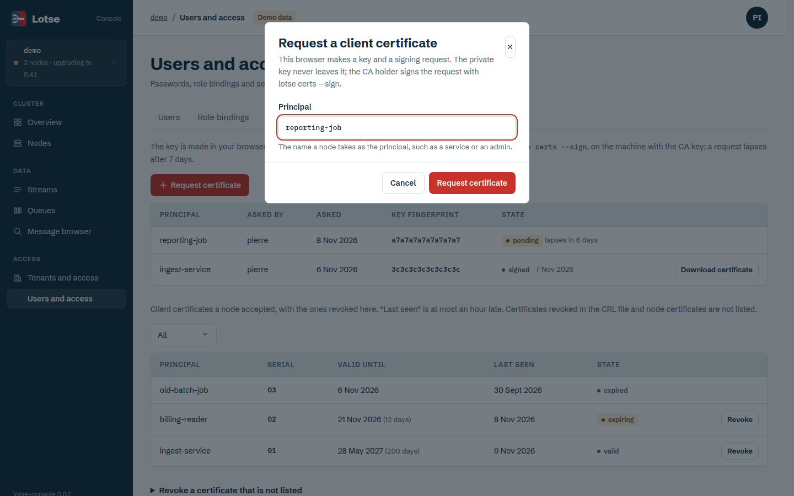

## When something is missing

If a stream or queue you expect is absent, check the tenant you are looking at and your role bindings first. What a principal may not see is unknown to it, so a missing permission looks like a missing resource.
